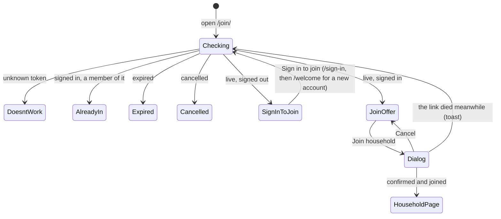

# Join a household from an invite link

Linear: TAS-110

## Summary

Members can make invite links (TAS-147, TAS-108 part 2), but `/join/<token>` opens the not-found page. This adds the join page at `/join/:token` and the two endpoints behind it. Anyone who opens a link sees whether it works. Signed out, they sign in first and come back to it. Signed in, they see the household's name and members and can join it; joining moves them out of their current household, and a dialog says so before it happens. They land on the household page. A cancelled or expired link says so, a link that was never valid gets its own "doesn't work" page, and a member who opens their own household's link is told they're already in it.

Building waits for TAS-147 (invite links), which adds `Invite`, `InviteStatus`, `make_invite`, `cancel_invite` and `invite_status` (`specs/TAS-108.md`, Part 2). This spec builds on that plan; where TAS-147 lands a name differently, use its name.

Evidence: feature. A new page with six states, a dialog and a move between households.
Design: needed. The join page is a new screen with six states and no board in `docs/design/` draws it.
Components: none new or changed expected. It reuses Page, Button, ConfirmDialog, Avatar, Squiggle, Loading, ErrorWithRetry and Toast; the design stage says so if it needs more.

## Required reading

- `AGENTS.md`: hard constraints, Domain areas, API contract, Tests.
- `specs/TAS-108.md`, Part 2: the `Invite` model, its states, `/api/household/invite/` and the link's address `/join/<token>`, which this page answers.
- `specs/TAS-109.md`: leaving and removing; its end-to-end journey through Remove and Leave lands here (Assumptions, line 274).
- `backend/households/services.py:93-108` `leave_household` and `:111-126` `remove_member`: mirror their transaction and lock order (household, then account) and the emptied household's deletion.
- `backend/households/views.py:99-163`: `household_body`, `signed_in_member`, `LeaveHouseholdView`; mirror their `extend_schema` and errors.
- `backend/tests/test_household.py:1-45`: `signed_up`, `leave`, `remove`, `member` and the `BrowserClient` use the new tests import.
- `frontend/src/households/household-page.tsx`: mirror `HouseholdContent` (session states), `Members` (the list), `LeaveHousehold` (ConfirmDialog, toasts, `whoStays`) and `takeFocus`.
- `frontend/src/households/household-api.ts`: mirror `useLeaveHousehold` and `useRemoveMember` (result unions, `setQueryData(HOUSEHOLD_KEY, …)`).
- `frontend/src/households/household-page.test.tsx:1-60`: mirror `answerSignedIn` and the stateful MSW handlers.
- `frontend/e2e/household.spec.ts`: the journey this spec extends.
- `docs/design.md`: Voice, States, Dialog, Error with retry, Components; and the approved join boards from the design stage.
- Lessons: `confirm-dialog-takes-focus-back.md` (focus after a join that comes back dead), `tanstack-refetch-resets-error-state.md` (the load errors through a retry), `move-the-approved-board-out-of-specs.md` (the boards move first), `design-doc-wins-over-a-board.md`, `radix-modal-menus-fail-axe.md` (the e2e opens the account menu).

## Product behaviour

One claim per acceptance criterion, in the issue's order:

1. Signed in, an invite link shows the household's name and members and a Join button; signed out, it shows whether the link works and a Sign in button that brings you back.
2. Join asks first in a dialog that names the household you'll leave and what happens to it.
3. A cancelled or expired link says which, and how to get a new one.

What else holds, each proved by a test below:

- After joining you're on the household page, in the new household, with a toast "You joined The Bedinis".
- A household left with nobody in it is deleted.
- A link that was never valid shows "This invite link doesn't work", not the not-found page.
- A member who opens their own household's link sees "You're already in The Bedinis" and a way to the household page, never Join.
- A link that dies between opening it and confirming says so, and nobody moves.
- Signed out, the page shows nothing about the household: no name, no members.

## Technical design

### How it works today

- `User.household` is a `PROTECT` foreign key, `related_name='members'` (`backend/households/models.py:45`). A named account always has one (`named_account_has_household`, `:58-63`).
- `leave_household` (`services.py:93`) and `remove_member` (`:111`) lock the household row, then the account, inside `transaction.atomic()`; leaving deletes the household if nobody is left.
- After TAS-147: `Invite(household, token, expires_at, cancelled_at)`, with `token` 43 random URL-safe characters and unique; `InviteStatus` has `LIVE` and `EXPIRED`; `invite_status(invite)` decides between them with `timezone.now()`; `make_invite` and `cancel_invite` lock the household row before writing; removing a member cancels the current invite; the household page shows `${origin}/join/${token}`.
- `/join/<token>` matches only `{ path: '*', Component: NotFoundPage }` (`frontend/src/app/routes.tsx:24`).
- Signing in through a link already comes back: `sign-in-page.tsx:348` follows `next` through `safeNextPath`, and `NameGate` (`name-gate.tsx:12`) sends a new, nameless account to `/welcome?next=/join/<token>`, which goes on to `next` once it has a name (`welcome-page.tsx:83`). Nothing changes there.
- `forgetHousehold` (`household-api.ts:49`) removes every query under `HOUSEHOLD_KEY` on sign-in and sign-out.

### The flow



### Model (`backend/households/models.py`, edit)

`InviteStatus` gains `CANCELLED = 'cancelled', 'Cancelled'`. No migration: no field's choices change (`InviteStatus` isn't a field's `choices`). If TAS-147 used it as a field's `choices`, `makemigrations households` makes the migration and it's committed.

### Services (`backend/households/services.py`, edit)

```py
class InviteNotLive(Exception):
    """The invite was cancelled or expired before the join could happen."""


@dataclass(frozen=True)
class InvitedHousehold:
    name: str
    members: list[Member]


@dataclass(frozen=True)
class InviteSeen:
    status: InviteStatus
    is_member: bool
    household: InvitedHousehold | None


def members_of(household_id: int, seen_by: User | None) -> list[Member]:
    """The household's members: whoever's looking first, if they're in it, then the others by name."""


def invite_seen_by(token: str, viewer: User | None) -> InviteSeen:
    """What `viewer` (None when signed out) may see of the invite. Raises Invite.DoesNotExist for an unknown token."""


def join_household(account: User, token: str) -> User:
    """Moves the account into the invite's household and deletes the household it left if that's now empty.
    Returns the account as saved. Raises Invite.DoesNotExist for an unknown token and InviteNotLive for a dead one."""
```

- `invite_status(invite)` returns `CANCELLED` when `cancelled_at` is set, before it looks at `expires_at`.
- `members_of` replaces `members_seen_by` (`services.py:78`). Its body is today's with `household_id` and `seen_by` in place of `account`: `is_you` is `member.pk == seen_by.pk` (always `False` for `None`). Its one caller, `household_body` (`views.py:101`), becomes `members_of(account.household_id, account)`.
- `invite_seen_by` loads `Invite.objects.select_related('household').get(token=token)`. `is_member` is `viewer is not None and viewer.household_id == invite.household_id`. `household` is `InvitedHousehold(name, members_of(invite.household_id, viewer))` when `viewer` is not `None` and either `is_member` or the status is `LIVE`; otherwise `None`. A signed-out viewer, or a signed-in one holding a dead link, learns only the status.
- `join_household`, in one `transaction.atomic()`:
  1. `invite = Invite.objects.get(token=token)`.
  2. Lock both households in `pk` order: `list(Household.objects.select_for_update().filter(pk__in={invite.household_id, account.household_id}).order_by('pk'))`. Then lock the account (`User.objects.select_for_update().get(pk=account.pk)`). Comment: every move locks households before accounts, and two households in `pk` order, so joins can't deadlock with each other, with leaving and removing, or with `make_invite` and `cancel_invite`.
  3. `invite.refresh_from_db()`, since a cancel may have committed while this waited for the household lock. Not `LIVE` → `raise InviteNotLive`.
  4. Already in the invite's household → return the account unchanged.
  5. Otherwise keep `left = account.household_id`, set `account.household_id = invite.household_id`, `save(update_fields=['household'])`, and delete `Household.objects.filter(pk=left)` when `not User.objects.filter(household_id=left).exists()`. Its invites go with it (`on_delete=CASCADE`).
  - Removed while it waited: the account's household is then a new household of one that only it is in and that has no invite, so step 5 goes on from it without its lock. Comment the line.
- Joining never cancels the joined household's link: anyone else sent it can still join.

### Serializers (`backend/households/serializers.py`, edit)

```py
class InvitedHouseholdSerializer(serializers.Serializer):
    name = serializers.CharField()
    members = MemberSerializer(many=True)


class JoinInviteSerializer(serializers.Serializer):
    status = serializers.ChoiceField(choices=InviteStatus.choices)
    is_member = serializers.BooleanField()
    household = InvitedHouseholdSerializer(allow_null=True)
```

`InvitedHousehold` has no `id` and no `invite`: whoever isn't a member gets the name and members only.

### Endpoints (`backend/households/views.py`, edit; `backend/config/urls.py`, edit)

```py
class InviteView(APIView):
    @extend_schema(
        operation_id='invite_retrieve',
        parameters=[OpenApiParameter('token', str, OpenApiParameter.PATH)],
        responses={200: JoinInviteSerializer, 404: None},
        description='Whether an invite link works and, for someone signed in, the household it joins. 404 for a '
        'token that was never an invite.',
    )
    def get(self, request: Request, token: str) -> Response: ...


class JoinView(APIView):
    @extend_schema(
        operation_id='invite_join_create',
        request=None,
        parameters=[OpenApiParameter('token', str, OpenApiParameter.PATH)],
        responses={200: HouseholdSerializer, 403: None, 404: None, 409: None},
        description="Moves the signed-in account into the invite's household; a household left with nobody in it is "
        'deleted. 404 for an unknown token, 409 when the link is cancelled or expired.',
    )
    def post(self, request: Request, token: str) -> Response: ...
```

- `InviteView.get`: `viewer = request.user if request.user.is_authenticated else None`; `Invite.DoesNotExist` → `NotFound`.
- `JoinView.post`: `join_household(signed_in_member(request), token)`; `Invite.DoesNotExist` → `NotFound`; `InviteNotLive` → `409` via a `rest_framework.exceptions.APIException` subclass `InviteNotLiveError` (`status_code = 409`, `default_detail = 'This invite link no longer works.'`, `default_code = 'invite_not_live'`) in `views.py`. Answers `household_body` of the account returned.
- `backend/config/urls.py`, after `api/household/members/…`: `path('api/invites/<str:token>/', InviteView.as_view(), name='invite')` and `path('api/invites/<str:token>/join/', JoinView.as_view(), name='invite-join')`.
- `backend/config/settings.py:232`: `ENUM_NAME_OVERRIDES` has `'InviteStatus': 'households.models.InviteStatus'` (added here if TAS-147 didn't), so both `status` fields share one enum and `--fail-on-warn` sees no collision.

### API contract

```diff
+GET  /api/invites/{token}/       → 200 {"status": "live" | "expired" | "cancelled", "is_member": bool,
+                                        "household": {"name": string, "members": [{"id", "name", "is_you"}]} | null} | 404
+POST /api/invites/{token}/join/  → 200 (as GET /api/household/) | 403 | 404 | 409
 GET  /api/household/             → "invite": {"status": "live" | "expired" | "cancelled", …} | null   (cancelled never sent)
```

`backend/schema.yml` and `frontend/src/api/schema.d.ts` are regenerated together. New components: `JoinInvite`, `InvitedHousehold`; `InviteStatus` gains `cancelled`.

### The household page (`frontend/src/households/household-page.tsx`, edit only if needed)

The household page never receives `cancelled` (its current invite is never a cancelled one). If TAS-147 picks the invite section from a map keyed by `InviteStatus`, the type now asks for a `cancelled` entry: it maps to the same component as no invite, which is how a cancelled link shows there. Nothing else changes.

### Hooks (`frontend/src/households/join-api.ts`, new)

```ts
export type JoinInvite = components['schemas']['JoinInvite'];

// Under HOUSEHOLD_KEY: what an invite shows depends on who's signed in, so forgetHousehold drops it with the rest.
export const inviteKey = (token: string) => [...HOUSEHOLD_KEY, 'invite', token];

export type InviteLookup = { kind: 'found'; invite: JoinInvite } | { kind: 'unknown' };

export const useInvite = (token: string) => {
  const { data, errorUpdatedAt, refetch } = useQuery({ queryKey: inviteKey(token), queryFn: … });
  return { lookup: data, errorUpdatedAt, refetch };
};

// 404 and 409 both mean the link stopped working after the page loaded it.
export type JoinResult = { kind: 'joined'; household: Household } | { kind: 'dead' };

export const useJoinHousehold = (token: string) => useMutation({ mutationFn: async (): Promise<JoinResult> => { … }, onSuccess: … });
```

- `useInvite`'s `queryFn` calls `api.GET('/api/invites/{token}/', { params: { path: { token } } })`: `200` → `found`; `404` → `unknown`; anything else throws.
- `useJoinHousehold` calls `api.POST('/api/invites/{token}/join/', …)`: `200` → `joined`; `404` or `409` → `dead`; anything else throws. `onSuccess`: `joined` → `setQueryData<Household>(HOUSEHOLD_KEY, household)` and `removeQueries({ queryKey: inviteKey(token), exact: true })`; `dead` → `invalidateQueries({ queryKey: inviteKey(token), exact: true })`.

### The page (`frontend/src/households/join-page.tsx`, new)

Built to the approved design; the visual values come from it, the behaviour and copy from here. `<title>Join a household · Tastebook</title>` in a `Page`. One component per state:

- `JoinContent` reads `useParams().token` and the session, as `HouseholdContent` does, except signed out doesn't redirect: session failed → `ErrorWithRetry` "Couldn't reach Tastebook"; pending → `<Loading>Checking your account…</Loading>`; known → `<InviteDetails token signedIn={account !== null} />`.
- `InviteDetails` calls `useInvite(token)`. No data and `errorUpdatedAt > 0` → `<ErrorWithRetry title="Couldn't open this invite link" onRetry={refetch}>Check your connection and try again.</ErrorWithRetry>`; no data → `<Loading>Opening the invite link…</Loading>`. With data, in this order:
  1. `unknown` → `DeadLink` `unknown`.
  2. `is_member` → `AlreadyMember`.
  3. `status` `expired` or `cancelled` → `DeadLink` with that status.
  4. Signed out → `SignInToJoin`.
  5. Otherwise → `JoinOffer`.
  It keeps `const [wentDead, setWentDead] = useState(false)`, set by `JoinOffer`'s `onDead`, and passes `DeadLink` `takeFocus={wentDead}`.
- `DeadLink` takes `reason: 'unknown' | 'expired' | 'cancelled'`, and its copy comes from one map:

  | reason | `h1` | text |
  | --- | --- | --- |
  | `unknown` | This invite link doesn't work | Check you have the whole link: it can get cut short when it's copied. If it still doesn't work, ask whoever sent it for a new one. |
  | `expired` | This invite link has expired | Invite links work for 7 days. Ask whoever sent it for a new one. |
  | `cancelled` | This invite link was cancelled | Someone in the household cancelled it. Ask them for a new one if you'd still like to join. |

  Then `<Button asChild><Link to="/">Back to Tastebook</Link></Button>`, as `NotFoundPage`. The `h1` has `tabIndex={-1}` and `ref={takeFocus ? focusOn : undefined}`, where `focusOn` is `household-page.tsx`'s `takeFocus` copied (a second use).
- `AlreadyMember`: `h1` "You're already in {household.name}"; text "This is your household's invite link. Send it to anyone you'd like to join you."; `<Button asChild><Link to="/household">Go to your household</Link></Button>`.
- `SignInToJoin`: `h1` "You've been invited to a household"; text "Sign in to see who's in it and join them. New to Tastebook? Signing in makes your account."; `<Button asChild><Link to={`/sign-in?next=${encodeURIComponent(`/join/${token}`)}`}>Sign in to join</Link></Button>`. Nothing about the household shows.
- `JoinOffer` takes the invite's `household`, the token and `onDead`. It calls `useHousehold()` for the household you'd leave: no data and `errorUpdatedAt > 0` → `ErrorWithRetry` "Couldn't load your household" with "Check your connection and try again."; no data → `<Loading>Getting your household…</Loading>`. With it:
  - `h1`: `Join {household.name}`, with the squiggle where the design puts it (one per screen).
  - Section "Members" (`h2`): a `<ul aria-labelledby>` with one `<li>` per member, in the API's order, `<Avatar name={member.name} />` then the name, keyed by `member.id`, as `Members` on the household page without Remove or "(you)".
  - A `ConfirmDialog` whose trigger is `<Button loading={join.isPending} loadingLabel="Joining…">Join household</Button>` (primary):
    - title `Join The Bedinis?` (the invite's household name)
    - description, when others stay in yours: `You'll leave Milo's household. Ann and Jo stay in it.` (names by `Intl.ListFormat('en-GB', { type: 'conjunction' })`, `stays` for one name, `stay` for more, as `whoStays` in `household-page.tsx`, copied: a second use)
    - description, when you're its only member: `You'll leave Milo's household. You're its only member, so it will be deleted.`
    - confirm `Join household`; the way out stays "Cancel".
  - Confirming: `joined` → `toast.success(`You joined ${household.name}`)` and `navigate('/household', { replace: true })`, so Back doesn't return to a link you've used. `dead` → `toast.info('This invite link stopped working before you joined.')` and `onDead()`; the page refetches and shows the dead link, its `h1` focused. A throw → `toast.error("Couldn't join the household. Check your connection and try again.")`, the offer stays, and the dialog's trigger keeps focus.
- `frontend/src/households/index.ts` (edit): export `JoinPage`.
- `frontend/src/app/routes.tsx` (edit): `{ path: '/join/:token', Component: JoinPage }` after `/household`, inside `NameGate`.

### Docs

- `GLOSSARY.md` › `households`: add **Join**, "Moving into a household from its invite link. You leave your current household, which is deleted if nobody's left in it.", in code `join_household()`. Invite's meaning gains ", until it expires or a member cancels it" if TAS-147 left it out.
- `docs/design.md` line 5: names the moved join boards (`join-page*.dc.html`) after the household page's.

## Decisions

- **Signed out, the page shows only whether the link works, then Sign in to join**; the household's name and members show only once signed in, because they're personal data that anyone holding a forwarded link would otherwise see (UK GDPR). Asked: what does someone who isn't signed in see? → Link's state, then sign in.
- **Join opens a dialog that names the household you'll leave and who stays in it, or that it will be deleted**, because joining can't be undone from this page and Voice asks a dialog to say exactly what happens. Asked: how does joining ask for confirmation? → Dialog after Join.
- **A link that was never valid gets its own page, "This invite link doesn't work"**, with how to fix it (a link cut short), rather than the not-found page. Asked: what does a link that was never valid show? → Its own "doesn't work" page.
- **After joining you land on the household page, with a toast**, so you see your new household and its members at once. Asked: where does someone land after joining? → The household page.
- **A member opening their own household's link sees "You're already in …" and a way to the household page**, whatever the link's state, since being in it is what matters to them. Asked: what does a member see on their own link? → "You're already in it" note.
- **One PR**, because the page can't be checked without its endpoints and the whole is about 15 files with generated ones. Asked: one PR or the API first? → One PR.
- **`InviteStatus` gains `cancelled`, one enum for both endpoints**, rather than a second enum whose `status` field would collide in drf-spectacular (`--fail-on-warn`). The household page never receives `cancelled`; if its type asks, `cancelled` shows as no link. (agent)
- **The lookup is open to visitors; joining needs sign-in and the CSRF header**, because the state is all a visitor learns, and a 43-character random token can't be guessed, so no rate limit is added. (agent)
- **Joining moves the account straight into the new household, not through `leave_household`**, which would make and throw away a household of one; it locks both households in `pk` order, then the account, and re-reads the invite under the lock, since `cancel_invite` takes the same household lock. (agent)
- **A link that dies between opening and confirming answers `409`, and the page shows the dead link with a toast**, so nobody moves on a cancelled link and the person sees why. An unknown token there (the household was deleted) is handled the same way. (agent)
- **The dialog confirms with "Join household", not the household's name**, because Dino's Button never wraps (`specs/TAS-109.md`, Decisions); the title names it. Its confirm is ConfirmDialog's danger button, as Leave's is, since joining leaves your household. (agent)
- **The invite query lives under `HOUSEHOLD_KEY`**, because what it answers depends on who's signed in, and sign-in and sign-out already drop everything under that key. (agent)
- **The end-to-end journey goes in `household.spec.ts`, not a new file**, so `signUpAs` isn't copied a third time; it also carries TAS-109's deferred Remove and Leave journey. (agent)

## Blast radius

- **`members_seen_by` becomes `members_of(household_id, seen_by)`.** Its one caller is `household_body` (`views.py:101`); `grep -rn members_seen_by backend` must find nothing after. `test_household.py`'s whole-body assertions prove the household page's answers didn't move.
- **`InviteStatus` gains `cancelled`.** `GET /api/household/`'s `invite.status` type widens in `schema.d.ts`; `pnpm lint` (type-check) finds any household page code that switches on it. Household page tests and fixtures are unchanged.
- **`routes.tsx`:** a new path before the catch-all; `not-found-page.test.tsx` still passes for other unknown paths.
- **The `HOUSEHOLD_KEY` prefix:** `useRemoveMember`'s `invalidateQueries({ queryKey: HOUSEHOLD_KEY })` now also marks an invite query stale; harmless, as no invite query is mounted on the household page.

## Out of scope

- The dialog's numbers of private recipes to be copied: TAS-121 (Keep the recipes you wrote when you leave a household).
- Showing who sent the link, a note from them, or which member invited whom.
- Emailing invites, links that work once, and a rate limit on lookups.
- Updating `test_household.py`'s `join` helper, which moves accounts directly; its comment ("Joining doesn't exist yet") goes stale and is a follow-up.
- Any change to sign-in, `/welcome` or `NameGate`: they already bring you back.
- The outsiders test across every endpoint: TAS-111.

## Steps

1. **Move the approved boards into `docs/design/`** per `specs/lessons/move-the-approved-board-out-of-specs.md`, as `docs/design/picnic/join-page*.dc.html` and `.dc.png`; `docs/design.md` (edit) names them.
   Done when: `pnpm lint` passes and `docs/design.md` links each moved board.
2. **Add the lookup and join endpoints.** `backend/households/models.py`, `services.py`, `serializers.py`, `views.py`, `backend/config/urls.py`, `backend/config/settings.py` (edit); `backend/schema.yml`, `frontend/src/api/schema.d.ts` (regenerated); `backend/tests/test_join.py` (new).
   Done when: `test_join.py` and `test_household.py` pass, `makemigrations --check --dry-run` reports no changes, and `spectacular --validate --fail-on-warn` passes.
3. **Add the hooks and the page.** `frontend/src/households/join-api.ts`, `join-page.tsx`, `join-page.test.tsx` (new); `index.ts`, `frontend/src/app/routes.tsx` (edit); `household-page.tsx` (edit only if its type asks for `cancelled`). Built to the approved boards.
   Done when: `join-page.test.tsx`, `household-page.test.tsx` and `not-found-page.test.tsx` pass.
4. **Add the journey.** `frontend/e2e/household.spec.ts` (edit).
   Done when: `pnpm test:e2e` passes locally and on the PR's preview.
5. **Update the glossary.** `GLOSSARY.md` (edit).
   Done when: the Join row is there.

## Tests

- `backend/tests/test_join.py` (new), through `/api/invites/<token>/` and `/api/invites/<token>/join/` with `BrowserClient`, using `signed_up`, `leave`, `remove` and `member` from `tests.test_household`. A link is made with `POST /api/household/invite/` and its token read from the response. Unsafe requests send `**browser.csrf_header()`. Time moves with `monkeypatch.setattr(timezone, 'now', …)`.
  - A live link, signed in, asserts: after Milo makes a link in "The Bedinis" with Ann in it, Jo's `GET` answers `200` `{'status': 'live', 'is_member': False, 'household': {'name': 'The Bedinis', 'members': [{'id': <Ann>, 'name': 'Ann', 'is_you': False}, {'id': <Milo>, 'name': 'Milo', 'is_you': False}]}}`, with no `email`, `id` or `invite` key on the household.
  - Parametrised over live, expired (7 days and a second on) and cancelled (`DELETE /api/household/invite/`), signed out, asserts: `200` with that `status`, `is_member: False` and `household: None`.
  - Parametrised over expired and cancelled, signed in as Jo, asserts: `200` with that `status` and `household: None`.
  - A member's own link, asserts: Milo's `GET` answers `is_member: True` and `household.name` "The Bedinis", with `is_you: True` on Milo's entry, first.
  - An unknown token, asserts: `GET` and Jo's `POST …/join/` both answer `404`.
  - Joining, asserts: Jo's `POST` answers `200` with `name: 'The Bedinis'` and members `['Jo', 'Ann', 'Milo']` with `is_you` `[True, False, False]`; `household_id_of('jo@example.com')` is The Bedinis's; Jo's old household no longer exists (`Household.objects.filter(pk=<old>).exists()` is `False`); Milo's `GET /api/household/` lists three members; the link is still live (`GET` answers `status: 'live'`).
  - Joining from a household with others, asserts: with Jo and Kim in "Jo's household", after Jo joins, that household still exists and Kim's `GET /api/household/` lists only Kim.
  - Parametrised over expired and cancelled, asserts: Jo's `POST` answers `409` and Jo's household is unchanged.
  - A member joining their own household's link, asserts: Ann's `POST` answers `200` with The Bedinis and `Household.objects.count()` unchanged.
  - Signed out, asserts: `POST` answers `403` and The Bedinis still has two members.
  - Without the CSRF header, asserts: Jo's `POST` answers `403` and Jo's household is unchanged.
  - A removed member's link, asserts: after Milo makes a link and removes Ann, Ann's `GET` with that token answers `status: 'cancelled'` and `household: None`.
- `backend/tests/test_household.py` (unchanged): passes as is, proving `members_of` kept the household page's answers.
- `frontend/src/households/join-page.test.tsx` (new), with `renderRoute('/join/tok-123')` and MSW. Signed in as Milo unless the case says otherwise. `GET /api/invites/tok-123/` answers `{status: 'live', is_member: false, household: {name: 'The Bedinis', members: [Ann, Jo]}}` (or the case's state); `GET /api/household/` answers Milo's household (`id: 11`, "Milo's household", members `[Milo (you)]`) until the join handler answers The Bedinis (`id: 10`, members Milo (you), Ann, Jo, `invite: null`) and switches to it. `document.cookie = 'csrftoken=abc'`; `toast.dismiss()` after each.
  - Signed in, a live link, asserts: the heading "Join The Bedinis" shows, the "Members" list's items read "Ann" and "Jo", and a "Join household" button shows.
  - Signed out, a live link, asserts: "You've been invited to a household" shows, the "Sign in to join" link's `href` is `/sign-in?next=%2Fjoin%2Ftok-123`, and neither "The Bedinis" nor "Ann" appears.
  - Parametrised over `expired`, `cancelled` and a `404`, signed out and signed in, asserts: the heading "This invite link has expired", "This invite link was cancelled" or "This invite link doesn't work", and a "Back to Tastebook" link to `/`.
  - Already a member, asserts: "You're already in The Bedinis" shows with a "Go to your household" link to `/household`, and no "Join household" button exists.
  - The dialog, others stay, asserts: with Milo's household holding Milo and Kim, "Join household" opens a dialog "Join The Bedinis?" reading "You'll leave Milo's household. Kim stays in it."; "Cancel" closes it and no `POST` was sent.
  - The dialog, the only member, asserts: it reads "You'll leave Milo's household. You're its only member, so it will be deleted."
  - Joining, asserts: confirming "Join household" sends one `POST /api/invites/tok-123/join/` with `X-CSRFToken` `abc`; the router lands on `/household`, the heading "Your household" shows with "Household name" holding "The Bedinis", and "You joined The Bedinis" shows.
  - Parametrised over `409` and `404` on join, asserts: "This invite link stopped working before you joined." shows; once the lookup answers `cancelled`, "This invite link was cancelled" shows and has focus.
  - Parametrised over a `500` and a network failure on join, asserts: "Couldn't join the household. Check your connection and try again." shows and "Join household" has focus.
  - The lookup failing, asserts: "Couldn't open this invite link" shows with "Try again"; after the handler answers and it's pressed, "Join The Bedinis" shows.
  - Loading, asserts: while the lookup is held, "Opening the invite link…" shows.
  - A nameless account, asserts: `/join/tok-123` lands on `/welcome` with search `?next=%2Fjoin%2Ftok-123`.
- `frontend/e2e/household.spec.ts` (edit). `signInFromTheBar`'s email and code steps move into `signInWithCode(page, email)` in the same file, used by it and by the join below. Two browser contexts, Sam and Ann.
  - Joining, leaving and being removed, asserts:
    1. Sam signs up, opens Household, makes a link and reads the address from "Invite link".
    2. Ann, signed out, opens it: "You've been invited to a household" shows and axe is clean; "Sign in to join", a new test account's code and the name "Ann" bring her back to the address, where "Join Sam's household" and a Members list reading "Sam" show.
    3. "Join household" opens the dialog reading "You'll leave Ann's household. You're its only member, so it will be deleted."; axe is clean with it open; confirming lands on `/household` with the Members list reading "Ann (you)", "Sam".
    4. Ann leaves: "Leave household" and confirming shows "Ann's household" with only "Ann (you)". (TAS-109's deferred Leave.)
    5. Ann opens the address again and joins again.
    6. Sam reloads Household and removes Ann: the Members list reads only "Sam (you)". (TAS-109's deferred Remove.)
    7. Ann opens the address: "This invite link was cancelled" shows and axe is clean.

Checks: `uv run ruff check . && uv run ruff format --check .`, `uv run python manage.py makemigrations --check --dry-run`, `uv run pytest` (in `backend/`); `spectacular --validate --fail-on-warn` and `pnpm generate:api` leaving no diff; `pnpm lint`; `pnpm test`; `pnpm test:e2e`; `pnpm --filter frontend build-storybook && pnpm --filter frontend test:visual` with no baseline changes.

## Assumptions

- **The copy above** (headings, texts, dialog, toasts, buttons) follows `docs/design.md` Voice; the design stage may change the wording and says so. Confirm with: Milo, at Design Review.
- **Being a member wins over the link's state**: a member opening their own cancelled or expired link sees "You're already in …", not the dead link. Confirm with: Milo, at spec approval.
- **When the only member of a household that has a live link joins another, their old link stops being an invite** (the household and its invites are deleted), so it shows "This invite link doesn't work". Confirm with: Milo, at spec approval.
- **The page loads the invite, then your household, one after the other**, rather than adding your household to the invite's answer; the second is often cached from the household page. Confirm with: Milo, at spec approval.
- **After joining, focus is where the router leaves it on the household page, and the toast announces the join.** Confirm with: Milo, at spec approval.
- **Building waits for TAS-147** (invite links), already marked as blocking this issue. Confirm with: Milo, at spec approval.

## Validation criteria

- [ ] The checks listed under Tests pass.
- [ ] `household.spec.ts` passes on the PR's preview, with axe clean on each join state it visits and with the dialog open.
- [ ] Behaviours 1 to 3 and the list under them are each proved by a backend, page or end-to-end test above.
- Evidence: feature. One laptop screenshot of the join offer; on a phone, signed out on a live link, the join offer, the dialog, the household page after joining, and a cancelled link; then the walkthrough. A preview can't age a link 7 days, so the expired state is proved by the page and backend tests, and the PR says so.
