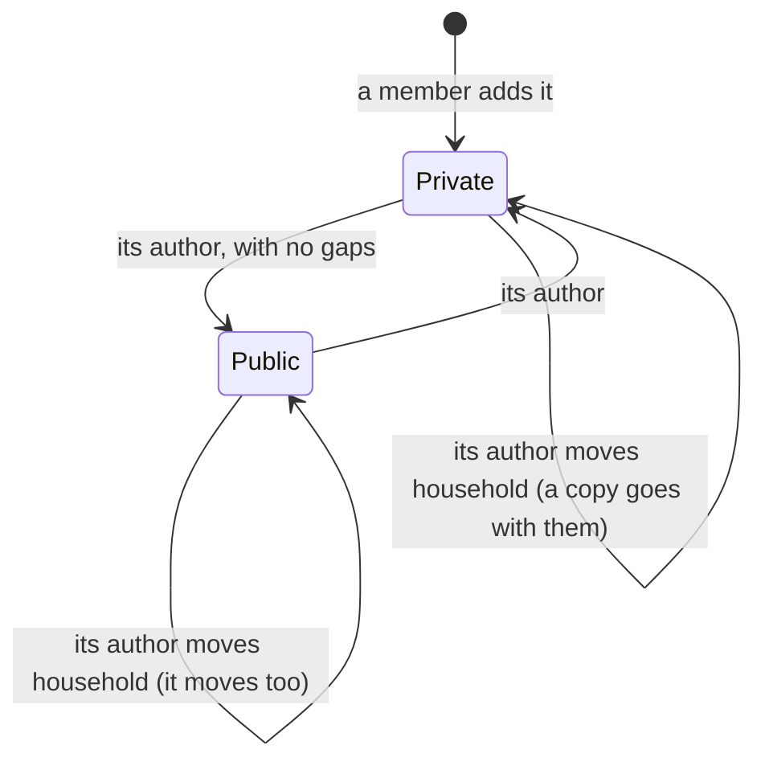

# Make your recipe public, and private again

Linear: TAS-119

## Summary

Today a recipe's visibility is worked out from its household (`backend/recipes/models.py:385`), so every household recipe is private for good. This lets a recipe's author publish it, credited "by <name>", and make it private again. Once public, anyone finds and opens it, signed in or not, and only its author can edit it. A recipe can go public only once it has ingredients, a method, prep and cook times, and servings or a yield. A public recipe moves with its author when they change household.

The work ships in two parts, each merging to `main` alone, in order:

- **Part 1 (this issue and branch): the API.** A stored `Recipe.visibility`, `PUT /api/recipes/<slug>/visibility/` for the author, the "by <name>" credit and the `can_edit` and `can_publish` flags in the API, public recipes in everyone's list and search, editing limited to the author, and public recipes moving with their author. Nothing changes on screen: no page can publish yet.
- **Part 2 (a sub-issue filed on approval): the recipe page.** The "Public" switch for the author, the confirm before publishing, "by <name>" on the page and the card, and "Edit recipe" following `can_edit`.

Design: needed — part 2 adds a Public switch and a confirm dialog to the recipe page and a "by <name>" credit on the page and the card; part 1 has no visual change.
Components: ConfirmDialog (changed: a primary confirm for an action that can be undone, opened from a switch rather than its own trigger button). Switch, Banner and toast are reused as they are.

Evidence: part 1: "No visible change." with the API tests' names; part 2: a walkthrough of Sam publishing "Grandma's curry", Cy in another household finding it "by Sam", Ben unable to edit it, and Sam making it private again.

## Required reading

- `AGENTS.md`: hard constraints, Tests, API contract, Standards (OWASP ASVS: authorisation on every object; UK GDPR: the author's name is shown only because they publish).
- `GLOSSARY.md`: Recipe, Public recipe, Private recipe, Household recipe, Author, Member, Join. Part 1 changes the first four, Member and Join, and adds Publish.
- `backend/recipes/models.py:217-238`: `visible_to`, `editable_by` and `deletable_by`, the one place each rule lives; the new `publishable_by`, `public` and `private` sit beside them. `:383-387`, the `visibility` property this replaces. `:361-371`, `recipe_catalogue_is_complete`, the shape for the new constraint. `:639-648`, the `member_moved` and `counting_recipes_to_copy` receivers.
- `backend/recipes/views.py:97-198`: `RecipeDetailView`; mirror `delete` for the refusals (403 before the lookup, 404 from a scoped queryset) and its `extend_schema`.
- `backend/recipes/services.py:108-178`: `add_recipe`, `edit_recipe` and `delete_recipe`, the shape for `set_visibility`. `:331-340`, `_load_recipes`, which must load catalogue recipes as public. `:406-419`, `_plain_fields`, which lets a seed record name its `visibility`.
- `backend/recipes/serializers.py:234-335`: `RecipeSummarySerializer` and `RecipeSerializer`, `can_delete` (l.334) the pattern for `can_edit` and `can_publish`.
- `backend/tests/test_deleting_recipes.py`, `test_editing_recipes.py:159-206`, `test_private_recipes.py:186-240` and `test_moving_recipes.py`: the refusal tables, the viewers (`stranger`, `another_household`, `another_member`, `its_author`) and the three ways an author moves (`leaves`, `is_removed`, `joins_jo`); mirror them.
- `backend/tests/test_household_privacy.py:120-131`: every route's outsider probes; the new route joins it.
- `backend/tests/test_recipes.py:268`: the list in three queries, which the author's name must not break.
- `frontend/src/recipes/recipe-intro.tsx`, `recipe-gaps.tsx`, `recipe-delete.tsx`, `recipes-api.ts`, `edit-recipe-page.tsx:50-56` and `recipes-page.tsx:40-70` (part 2): where the switch, the credit and `can_edit` go, and `useDeleteRecipe` and `DeleteRecipe`, the hook and the page handling to mirror.
- `frontend/src/dino/switch.tsx` and `confirm-dialog.tsx` (part 2): the switch as it is, and the dialog part 2 changes.
- `docs/design.md`: Private mark (l.170), Switch (l.174), Dialog (l.180), and principle 3 (l.17), which part 2's confirm departs from on purpose.
- Lessons: `confirm-dialog-trigger-shows-its-request.md` and `confirm-dialog-takes-focus-back.md` (part 2's confirm), `handle-every-documented-answer.md` (part 2 tests every answer of the new endpoint), `blank-model-fields-are-optional-in-the-schema.md`, `request-field-defaults-are-required-in-the-schema.md`, `design-doc-wins-over-a-board.md`, `spec-questions-hold-for-every-earlier-answer.md`.

## Product behaviour

**Part 1: the API**

1. Only a recipe's author can make it public, and only while it's in their household.
2. A recipe missing ingredients, method, prep time, cook time or servings can't go public.
3. Anyone, signed in or not, finds and opens a public household recipe.
4. A public household recipe gives its author's name; private and catalogue recipes give none.
5. Only its author can edit a public recipe; the rest of the household can't.
6. An edit that would leave a public recipe missing one of those parts is refused.
7. The author can make a public recipe private again, hiding it from everyone else.
8. A public recipe moves with its author when they leave, are removed or join.

**Part 2: the recipe page**

9. Only the author sees a "Public" switch on their recipe's page.
10. Turning the switch on asks the author to confirm before the recipe goes public.
11. The switch can't be turned on while the page lists something missing.
12. Turning the switch off makes the recipe private at once.
13. A public household recipe shows "by <name>" under its title and on its card.
14. "Edit recipe" shows only to someone who may edit the recipe.

What else holds, each proved by a test below:

- A catalogue recipe stays public, and nobody can change its visibility (404).
- Asking for the visibility a recipe already has changes nothing and answers 200.
- The leave and join dialogs' count covers only the private recipes that will be copied.
- A private recipe's page, card and edit form look exactly as they do today.

## Technical design

### How it works today

- `Recipe.visibility` is a property: public when `household` is empty (the catalogue), private otherwise (`models.py:383-387`).
- `visible_to(user)` gives the catalogue plus the user's own household's recipes; `editable_by(member)` gives every recipe of the member's household; `deletable_by(user)` gives those the user wrote, or whose author has left (`models.py:217-238`).
- When a member moves, `copy_recipes_written` copies every recipe they wrote in the old household into the new one, and `count_recipes_written` gives the count the leave and join dialogs show (`models.py:639-648`).
- The recipe page shows the private mark, "What's missing" and "Edit recipe" only when `visibility` is `private` (`recipe-intro.tsx:99-120`, `recipe-gaps.tsx:34`), and the edit page sends a public recipe back to its page (`edit-recipe-page.tsx:53`).

### Part 1: the API

- **Model** (`backend/recipes/models.py`): `Recipe.visibility` becomes a stored field and the property goes.

  ```python
  visibility = models.CharField(
      max_length=7,
      choices=Visibility.choices,
      default=Visibility.PRIVATE,
      help_text='A catalogue recipe is always public; a household recipe is private until its author publishes it.',
  )
  ```

  A new check constraint in `Recipe.Meta.constraints`, after `recipe_catalogue_is_complete`:

  ```python
  models.CheckConstraint(
      condition=models.Q(household__isnull=False) | models.Q(visibility=Visibility.PUBLIC),
      name='recipe_catalogue_is_public',
      violation_error_message='A catalogue recipe is always public.',
  ),
  ```

  What a public recipe must have can't be a constraint (ingredients and steps are other tables), so the service checks it.

- **Migration** `backend/recipes/migrations/0018_recipe_visibility.py`: `AddField` with the default `private`; a `RunPython` that sets `visibility='public'` on every recipe with no household (reverse: `RunPython.noop`); then `AddConstraint`. Every household recipe today is private, so nothing else moves.

- **Querysets** (`RecipeQuerySet`):

  ```python
  def public(self) -> RecipeQuerySet:
      return self.filter(visibility=Visibility.PUBLIC)

  def private(self) -> RecipeQuerySet:
      return self.filter(visibility=Visibility.PRIVATE)

  def visible_to(self, user: User | AnonymousUser) -> RecipeQuerySet:
      """Public recipes, and the recipes of the user's household when they're signed in to one."""
      household_id = user.household_id if user.is_authenticated else None
      if household_id is None:
          return self.public()
      return self.filter(Q(visibility=Visibility.PUBLIC) | Q(household_id=household_id))

  def editable_by(self, user: User | AnonymousUser) -> RecipeQuerySet:
      """The recipes an account may edit: its household's private recipes, whoever wrote them, and the public ones
      it wrote."""
      household_id = user.household_id if user.is_authenticated else None
      if household_id is None:
          return self.none()
      return self.filter(household_id=household_id).filter(Q(visibility=Visibility.PRIVATE) | Q(created_by=user))

  def publishable_by(self, user: User | AnonymousUser) -> RecipeQuerySet:
      """The recipes an account may make public or private: those of its household it wrote. A catalogue recipe has
      no household, so nobody may."""
      household_id = user.household_id if user.is_authenticated else None
      if household_id is None:
          return self.none()
      return self.written_by_in(user, household_id)
  ```

  `editable_by` now takes `User | AnonymousUser`, as `deletable_by` does, so the serializer can ask it for anyone. `catalogue()` stays "no household": the catalogue load still uses it. `deletable_by` doesn't change.

- **Moving** (the receivers at the end of `models.py`): `copy_recipes_written` becomes `take_recipes_written` (`dispatch_uid='recipes-take-written-recipes'`):

  ```python
  written = Recipe.objects.written_by_in(account, left)
  # One public recipe, still its author's to edit, rather than a stranded original and a duplicate.
  written.public().update(household_id=account.household_id)
  written.private().copy_into(account.household_id)
  ```

  `member_moved` is sent before a household left empty is deleted, so a public recipe has moved before the cascade. `count_recipes_written` counts `written_by_in(...).private()`, so the dialogs' "Your 4 private recipes will be copied" stays true. A public recipe's slug, photo and rows stay as they are: it's the same recipe.

- **Service** (`backend/recipes/services.py`):

  ```python
  def publishing_gaps(recipe: Recipe) -> list[str]:
      """What a recipe needs before it can be public, in the order the recipe page's "What's missing" lists them.
      An ingredient awaiting review isn't one: it only holds back the diet tags."""

  def set_visibility(recipe: Recipe, visibility: Visibility) -> Recipe:
      """Makes the recipe public or private. Raises ValidationError({'visibility': [...]}) when it's made public
      while publishing_gaps() names something."""
  ```

  `publishing_gaps` gives, each only when missing: `'ingredients'` (no ingredient line, grouped or not), `'a method'` (no step), `'a prep time'`, `'a cook time'`, `'servings or a yield'` (both empty). `set_visibility` saves only `visibility` (`save(update_fields=['visibility'])`); making a recipe private never checks gaps. Its refusal reads `Add <gaps> before making it public.`, the gaps joined by commas and a final "and" with no Oxford comma: "Add a method and a cook time before making it public.", "Add ingredients, a method, a prep time, a cook time and servings or a yield before making it public." A private `_together(parts: list[str]) -> str` does the joining, used by both messages.

  `edit_recipe` checks the same after it has set the ingredients and steps, inside its transaction, when `recipe.visibility` is public: with gaps it raises `ValidationError('A public recipe needs <gaps>, so these changes can't be saved. Make it private first.')`, which rolls the edit back and reaches the client as `non_field_errors` through the view's existing mapping (`views.py:160-165`). The edit form already shows `non_field_errors` (`recipe-form.tsx:199`).

- **Catalogue and seed:** `_load_recipes` builds each recipe with `visibility=Visibility.PUBLIC` over whatever the record says (`Recipe(slug=…, **{**_plain_fields(…), 'visibility': Visibility.PUBLIC})`). `_plain_fields` already accepts any editable field, so a seed recipe record may give `"visibility": "public"`; the seed doesn't check gaps, as it doesn't check anything the form asks for. No change to `backend/seed/`.

- **Serializers** (`backend/recipes/serializers.py`):
  - `RecipeSummarySerializer` gains `author`, after `visibility`: a `SerializerMethodField` typed `@extend_schema_field(serializers.CharField(allow_null=True))`, with `help_text='The name of whoever wrote a public household recipe, shown as "by <name>"; null for a private or catalogue recipe.'`. It gives `recipe.created_by.name` when `recipe.visibility` is public and `recipe.household_id` is set and `created_by` isn't empty, else `None`. `RecipeSerializer` inherits it, so the card and the page both have it.
  - `RecipeSerializer` gains, after `can_delete`, `can_edit` (`help_text='Whether the signed-in account may edit this recipe: any member of its household while it is private, only its author once it is public.'`) and `can_publish` (`help_text='Whether the signed-in account may make this recipe public or private: its author, while it is in their household.'`), each a `SerializerMethodField` typed `OpenApiTypes.BOOL` that asks `editable_by` or `publishable_by` for the recipe's pk, as `get_can_delete` does.
  - New `RecipeVisibilitySerializer(serializers.Serializer)` with one field, `visibility = serializers.ChoiceField(choices=Visibility.choices, error_messages={'required': 'Say whether the recipe is public or private.', 'invalid_choice': 'Say whether the recipe is public or private.'})`. No default (lesson `request-field-defaults-are-required-in-the-schema.md`): it's required.

- **Queries:** `RecipeListView.get_queryset`, `RecipeDetailView.get_queryset` and the refetch in `RecipeListView.post` add `.select_related('created_by')`, so the author's name costs no query per recipe; `test_searches_in_three_queries` (`test_recipes.py:268`) must still pass at three. `can_edit` and `can_publish` add one query each to a detail answer, as `can_delete` does.

- **Endpoint** (`backend/recipes/views.py`, `backend/recipes/urls.py`): `RecipeVisibilityView(APIView)` with `permission_classes = []` and one method, `put`, routed at `path('<slug:slug>/visibility/', RecipeVisibilityView.as_view(), name='recipe-visibility')`.

  ```python
  @extend_schema(
      operation_id='recipes_visibility_update',
      request=RecipeVisibilitySerializer,
      responses={
          200: RecipeSerializer,
          400: OpenApiResponse(description="The visibility isn't public or private, or the recipe lacks something a "
                                           'public recipe needs: ingredients, a method, prep and cook times, servings '
                                           'or a yield.'),
          403: OpenApiResponse(description='Signed out, or the account has no household yet.'),
          404: OpenApiResponse(description="No recipe has this slug that the account may publish: there's none, it's "
                                           "another household's or a catalogue recipe, or another member wrote it."),
      },
      description='Makes a recipe of the signed-in account\'s household public or private. Only its author may. '
                  'Asking for the visibility it already has changes nothing.',
  )
  ```

  `put` refuses with 403 before the lookup when signed out or without a household, looks the recipe up with `get_object_or_404(Recipe.objects.publishable_by(request.user), slug=slug)`, validates the body, calls `set_visibility`, maps a `DjangoValidationError` to a DRF `ValidationError` as `patch` does, and answers `RecipeSerializer` from `RecipeDetailView`'s queryset (`visible_to(...).select_related('created_by').prefetch_related(...).with_ingredients_and_method()`; reuse it by moving that chain to a module-level `_detail_queryset(user)` in `views.py`, which both views call). `RecipeDetailView.patch`'s description changes to "Edits a recipe of the signed-in account's household: any member may edit a private recipe, only its author a public one. …" and its 404 to "…, it's a catalogue recipe, or it's public and another member wrote it."

- **API contract:** regenerate `backend/schema.yml` and `frontend/src/api/schema.d.ts`.

  ```diff
   RecipeSummary:
  +  author: string | null
   Recipe (extends RecipeSummary):
  +  can_edit: boolean
  +  can_publish: boolean
  +PUT /api/recipes/{slug}/visibility/   body RecipeVisibility { visibility: "public" | "private" }
  +  200 Recipe · 400 {"visibility": ["Add a method and a cook time before making it public."]} · 403 · 404
   PATCH /api/recipes/{slug}/
  +  400 {"non_field_errors": ["A public recipe needs a method, so these changes can't be saved. Make it private first."]}
  +  404 also for a public recipe another member wrote
  ```

  The new fields are required in every `Recipe` and `RecipeSummary`, so every typed fixture in the frontend gains them (`author: null, can_edit: true, can_publish: true` for a private recipe the viewer wrote; `author: null, can_edit: false, can_publish: false` for a catalogue recipe), with no other frontend change in part 1.

- **Glossary** (`GLOSSARY.md`): Public recipe: "A recipe anyone can find and open, signed in or not: a catalogue recipe, or a household recipe its author has published, shown "by <name>"." In code `Recipe.visibility`, `RecipeQuerySet.public`. Private recipe: in code `Recipe.visibility`, `RecipeQuerySet.private`. Household recipe: "…, private until its author publishes it; any member can edit it while it's private, only its author once it's public; only its author can delete it…", in code adding `RecipeQuerySet.editable_by`. New row **Publish**: "Making a household recipe public, which only its author can, once it has ingredients, a method, prep and cook times and servings or a yield. Making it private again undoes it." In code `set_visibility()`, `publishing_gaps()`, `RecipeQuerySet.publishable_by`. Member and Join: "…takes a copy of each private recipe they wrote…; a public recipe they wrote moves with them."



### Part 2: the recipe page

Part 2 waits on the approved design; where its boards draw something this section doesn't, `docs/design.md` and the boards decide and the part's PR lists each difference (lesson `design-doc-wins-over-a-board.md`).

- **Hook** (`frontend/src/recipes/recipes-api.ts`): `useSetVisibility(slug)`, a mutation mirroring `useDeleteRecipe`, sending `api.PUT('/api/recipes/{slug}/visibility/', { body: { visibility } })` and answering

  ```ts
  export type VisibilityChange =
    | { kind: 'changed'; recipe: Recipe }
    | { kind: 'refused'; message: string } // 400: the API's first visibility message
    | { kind: 'signed-out' } // 403
    | { kind: 'gone' }; // 404
  ```

  On `changed` it sets `['recipes', slug]` to the answer and invalidates the other `['recipes', …]` queries, as `useAddRecipe` does; on `refused` and `gone` it invalidates `['recipes']`, so the page shows what's true now. Any other status throws.

- **Switch** (`frontend/src/recipes/recipe-visibility.tsx`, new): `RecipeVisibility({ recipe })`, rendered by `RecipeIntro` only when `recipe.can_publish`, under the credit or private mark. Dino's `Switch` labelled `Public`, checked when `recipe.visibility === 'public'`. While the recipe has a gap other than an ingredient awaiting review (`publishingGaps(recipe)`, a new export of `recipe-gaps.tsx` giving `recipeGaps` without the "No diet tags until…" line), the switch is disabled with the reason `Add what's missing before making it public.` and the "What's missing" banner above says what.
  - **On:** opens the confirm dialog. Title `Make this recipe public?`; description `Anyone can find <title>, credited “by <name>”, and only you will be able to edit it. You can make it private again.`, `<name>` from the session's `account.name`; confirm `Make public`, pending `Making public…`; cancel `Cancel`. Confirming sends the request; the switch stays off until it answers.
  - **Off:** sends the request at once, no dialog.
  - **Answers:** `changed` to public toasts `<title> is public`; to private, `<title> is private again`. `refused` toasts the API's message as an error. `gone` toasts `<title> has been deleted, or you can't change it any more.` as info. `signed-out` asks the session again, as `DeleteRecipe` does: signed out, it goes to `/sign-in?next=/recipes/<slug>`; still signed in, it toasts `Couldn't change who can see <title>. Check your connection and try again.` as an error, the same toast a thrown request gives. While a request runs the switch is disabled with the reason `Saving…`.
  - **Focus:** after the dialog closes, on any answer, focus goes back to the switch, which stays on the page.

- **ConfirmDialog** (`frontend/src/dino/confirm-dialog.tsx`, changed, with its stories): two additions, both optional so every caller today is unchanged. `tone?: 'danger' | 'primary'` (default `danger`) picks the confirm button's variant. And a controlled form for a dialog opened by something other than its own button: `open` and `onOpenChange` in place of `trigger`, in which the confirm button shows `pending` with `pendingLabel` and the dialog stays open until `pending` is false. The props are a union, so a dialog has either `trigger` or `open`, never both. `docs/design.md`'s Dialog row gains: "A change that can be undone but reaches beyond the household (making a recipe public) may ask first, with a primary button that names it ("Make public")."

- **Credit** (`frontend/src/recipes/recipe-intro.tsx`, `recipes-page.tsx`): when `recipe.author` isn't null, the page shows `by <author>` in Muted under the title, where a private recipe shows its mark; the card shows it in its meta block above the time and difficulty, where a private card shows its mark. Plain text in the recipes area, not a Dino component, unless the approved design names it as part of the look.

- **Editing:** `RecipeIntro` shows "Edit recipe" when `recipe.can_edit`, not when it's private. `RecipeToEdit` (`edit-recipe-page.tsx:53`) sends anyone with `!data.can_edit` back to the recipe's page, a catalogue recipe included.

- **E2E setup** (`frontend/e2e/setups.ts`): `publishedRecipe`, Sam and Ben in "Sam's household" and Cy in "Cy's household", Sam having written "Grandma's curry" complete (two ingredient lines, two steps, prep 20, cook 40, serves 4) and private.

## Decisions

- Two parts: the API first, with no visible change, then the recipe page, because it's about 20 files and over 600 lines together and part 1 can merge while part 2 is designed. Asked: one PR or the API first? → API first, then the page.
- A recipe can go public only with no gap the "What's missing" banner lists: ingredients, a method, prep and cook times, servings or a yield. An ingredient awaiting review doesn't block it, as it only holds back the diet tags. Asked: what must a recipe have before it's public? → No gaps the banner lists.
- The author publishes with a "Public" switch on the recipe's page, shown only to them, not in the edit form, which any member opens. Asked: where does the author make it public? → Switch on the recipe page.
- Publishing asks to confirm; making it private acts at once, because publishing shows the recipe to everyone with the author's name and takes editing from the household, while unpublishing only narrows who sees it. This departs from `docs/design.md` principle 3 (offer Undo rather than asking), so part 2 adds the rule to the Dialog row. Asked: confirm before publishing? → Confirm publishing only.
- "by <name>" shows under the title on the page and on the card, so browsing tells household recipes from the catalogue. Asked: where does "by <name>" show? → Page and card.
- A public recipe moves to its author's new household when they leave, are removed or join; private ones are copied as today. One public recipe stays editable by its author and visible to the old household as public, instead of a stranded original nobody may edit and a duplicate. Asked: what happens when the author moves? → It moves with the author.
- Visibility is a stored field with a constraint that keeps the catalogue public, not still worked out from the household, because a household recipe can now be either.
- A dedicated `PUT /api/recipes/<slug>/visibility/` rather than `visibility` in the PATCH, because who may change it (the author) differs from who may edit (any member, while private), and publishing has its own check. (agent)
- A non-author asking to publish gets 404, as deleting does (`views.py:183-188`), so the refusals stay one pattern; `can_publish` keeps the page from ever offering it. (agent)
- An edit that would leave a public recipe with a gap is refused, so a public recipe can't lose what publishing required. (agent)
- `author` is `null` for private recipes, though their household could see the name, because only publishing puts it on show; the API never sends a name no screen uses. (agent)
- No row locks: a member's edit landing in the same instant as the author's publish could slip through once, as a delete racing an edit can today. Not worth a lock on every edit. (agent)

## Blast radius

- `RecipeQuerySet.visible_to` decides what the list, search, filters and detail show to everyone. Re-check `test_private_recipes.py`, `test_household_privacy.py` and `test_recipes.py`: signed out, the list must still hold every catalogue recipe and no private one.
- `editable_by` changes signature (`User | AnonymousUser`) and meaning. Its only caller is `RecipeDetailView.patch`; re-run `test_editing_recipes.py`, `test_recipe_ingredients.py`, `test_recipe_method.py` and `test_recipe_photos.py`.
- The `member_moved` receiver is renamed and now moves rows. Re-run `test_moving_recipes.py`, `test_household.py` and `test_join.py`; joining as a household's only member must keep a public recipe through the old household's deletion.
- `_load_recipes`: re-run `test_catalogue.py`; a reload must leave household recipes, public ones included, alone (it deletes only `catalogue()`).
- The schema's `Recipe` and `RecipeSummary` gain required fields, so every typed fixture breaks the type check until it has them: `frontend/src/test/handlers.ts`, `recipes/recipe-page.test.tsx`, `edit-recipe-page.test.tsx`, `new-recipe-page.test.tsx`, `recipe-gaps.test.ts`, `deletion-warning.test.ts`, `households/sign-in-page.test.tsx`, `frontend/e2e/phone-width.spec.ts` and any `RecipeSummary` fixture (`recipes-page.test.tsx`).
- Part 2's ConfirmDialog change reaches every dialog (household page, join page, delete recipe); the default `tone` and the `trigger` form keep them as they are, and their visual baselines must not change.

## Out of scope

- What people who saved a recipe see when it goes private: TAS-123 (Save recipes to Favourites).
- "Adapted from …" credits and publishing a copy: TAS-127 (Publish a copy as an adaptation).
- Share links: TAS-128. Holding a busy day's recipes: TAS-131. Reporting: TAS-129.
- A public recipe whose author deletes their account, and its "a former member" credit: TAS-134 (Delete your account). Until then `author` is `null` when `created_by` is empty, and `deletable_by` is unchanged.
- Saying in the leave and join dialogs that public recipes move along: the count stays private recipes only.
- Offering another household an ingredient awaiting review that a public recipe uses (`IngredientQuerySet.offered_to`): the recipe still shows it; the filters don't offer it.
- The admin: it lists only catalogue recipes and stays read-only.

## Steps

### Part 1 (this branch)

1. **Store visibility.** `backend/recipes/models.py` (edit), `backend/recipes/migrations/0018_recipe_visibility.py` (new).
   Add the field and constraint, drop the property, add `public()`, `private()`, `publishable_by()`, and change `visible_to()` and `editable_by()` as above. Load the catalogue as public in `backend/recipes/services.py`'s `_load_recipes`.
   Done when: `uv run --env-file .env python manage.py makemigrations --check` is clean, and `uv run pytest tests/test_catalogue.py tests/test_private_recipes.py tests/test_recipes.py` passes.

2. **Publish and unpublish.** `backend/recipes/services.py`, `serializers.py`, `views.py`, `urls.py` (edit), `backend/tests/test_publishing_recipes.py` (new), `backend/tests/test_household_privacy.py` (edit).
   Add `publishing_gaps`, `set_visibility`, `_together`, `RecipeVisibilitySerializer`, `RecipeVisibilityView` and its route, `author`, `can_edit`, `can_publish` and the `select_related`. Add the route's probes to `ENDPOINTS`: `put('/api/recipes/no-such-recipe/visibility/', {'visibility': 'public'})` and `put('/api/recipes/{recipe}/visibility/', {'visibility': 'public'})`, with a `put` helper beside `patch` if there's none.
   Done when: `uv run pytest tests/test_publishing_recipes.py tests/test_household_privacy.py tests/test_recipes.py` passes.

3. **Keep a public recipe whole.** `backend/recipes/services.py` (`edit_recipe`), `backend/tests/test_editing_recipes.py` (edit).
   Refuse an edit leaving a public recipe with a gap, and let `editable_by` refuse other members.
   Done when: `uv run pytest tests/test_editing_recipes.py tests/test_recipe_ingredients.py tests/test_recipe_method.py` passes.

4. **Move a public recipe with its author.** `backend/recipes/models.py` (receivers), `backend/tests/test_moving_recipes.py` (edit).
   Done when: `uv run pytest tests/test_moving_recipes.py tests/test_household.py tests/test_join.py` passes.

5. **Regenerate the contract and the fixtures.** `backend/schema.yml`, `frontend/src/api/schema.d.ts` (generated), the fixtures listed under Blast radius (edit).
   Done when: `pnpm generate:api` leaves no diff, and `pnpm lint` and `pnpm test` pass with no other frontend change.

6. **Glossary.** `GLOSSARY.md` (edit), as above.
   Done when: every row the Technical design names reads as written there.

### Part 2 (its own issue, after the design is approved)

7. **ConfirmDialog's tone and controlled form.** `frontend/src/dino/confirm-dialog.tsx`, `confirm-dialog.stories.tsx` (edit), `docs/design.md` (Dialog row), the approved boards moved into `docs/design/` (lesson `move-the-approved-board-out-of-specs.md`), new baselines.
   Done when: the new stories pass `pnpm test` and every existing dialog's baseline is unchanged.

8. **The switch and its hook.** `frontend/src/recipes/recipes-api.ts`, `recipe-gaps.tsx`, `recipe-intro.tsx` (edit), `recipe-visibility.tsx` (new), `recipe-page.test.tsx` (edit).
   Done when: `pnpm test` passes, the documented-answers check included.

9. **The credit and editing.** `recipe-intro.tsx`, `recipes-page.tsx`, `edit-recipe-page.tsx` and their tests (edit).
   Done when: `pnpm test` passes.

10. **The journey.** `frontend/e2e/setups.ts` (edit), `frontend/e2e/recipe-publish.spec.ts` (new).
    Done when: `pnpm test:e2e` passes locally.

## Tests

### Part 1

- `backend/tests/test_publishing_recipes.py` (new; reuse `milos_curry`, `ben_in_milos_household` and the viewers from `test_private_recipes.py`; a helper `complete_curry()` gives Milo's curry two lines, two steps, prep 15, cook 30 and serves 4; `publish(browser, slug, visibility='public')` sends the PUT)
  - the author makes a complete recipe public, asserts: 200, the body's `visibility` is `"public"` and `author` is `"Milo"`, and the row's `visibility` is `public`.
  - parametrised over the gap removed (no lines, no steps, no prep, no cook, no servings) and all five at once, asserts: 400 with `{"visibility": ["Add ingredients before making it public."]}`, `["Add a method before making it public."]`, `["Add a prep time before making it public."]`, `["Add a cook time before making it public."]`, `["Add servings or a yield before making it public."]`, and `["Add ingredients, a method, a prep time, a cook time and servings or a yield before making it public."]`, and the row stays `private`.
  - a recipe whose only line uses an ingredient awaiting review goes public, asserts: 200 and `visibility` `"public"`.
  - a yield instead of servings counts, asserts: 200.
  - parametrised refusals (signed out 403, without the CSRF header 403, with no name yet 403, another member of the household 404, another household 404, a catalogue recipe 404, no such slug 404), asserts: the status and the row's `visibility` still `private` (the catalogue's still `public`).
  - parametrised bad bodies (`{}`, `{"visibility": "friends"}`), asserts: 400 with `{"visibility": ["Say whether the recipe is public or private."]}`.
  - asking for the visibility it has (public to public, private to private), asserts: 200 and the visibility unchanged.
  - the author makes a public recipe private again, asserts: 200, `visibility` `"private"`, `author` `null`; then `stranger()` and `another_household()` get 404 on its address and its title is gone from their list.
  - a private recipe with gaps goes private again without a check, asserts: a public recipe whose steps were removed in the database answers 200 when made private.
  - parametrised viewers (`stranger`, `another_household`, `another_member`, `its_author`) of a public recipe, asserts: each finds its title in `GET /api/recipes/?q=curry` and opens its address with 200, `author` `"Milo"`.
  - `author` by recipe, asserts: `"Milo"` for the public curry, `null` for a private recipe Milo wrote, `null` for a catalogue recipe, in both the list and the detail.
  - parametrised `can_edit` and `can_publish` by viewer and visibility, asserts: private, author `(true, true)`, other member `(true, false)`, another household's viewer can't see it; public, author `(true, true)`, other member `(false, false)`, another household `(false, false)`, signed out `(false, false)`; catalogue, signed in `(false, false)`.
  - the list with a public household recipe stays in three queries, asserts: `django_assert_num_queries(3)` around `GET /api/recipes/` with two public recipes by two authors.
- `backend/tests/test_editing_recipes.py`
  - another member edits a public recipe, asserts: 404 and the title unchanged.
  - the author edits their public recipe's title, asserts: 200 and the new title.
  - parametrised edits that leave a public recipe with a gap (`{"steps": []}`, `{"ingredient_lines": [], "ingredient_groups": []}`, `{"cook_minutes": null}`, `{"servings": null}`), asserts: 400 with `{"non_field_errors": ["A public recipe needs a method, so these changes can't be saved. Make it private first."]}` (and "ingredients", "a cook time", "servings or a yield"), and the recipe's steps, lines and fields unchanged in the database.
  - the same edit on a private recipe, asserts: 200.
- `backend/tests/test_moving_recipes.py`
  - parametrised over `leaves`, `is_removed`, `joins_jo`: Milo's public curry moves, asserts: the same row (same pk and slug) now has Milo's new household, stays `public`, Ann's list still shows it with `author` `"Milo"` and `can_edit` false, and no copy of it exists; Milo's private Flatbreads is copied as before.
  - joining as the only member keeps the public recipe, asserts: the old household is gone and the public curry exists in Jo's household.
  - the link's `recipes_to_copy` with one private and one public recipe written, asserts: `1`.
- `backend/tests/test_catalogue.py`
  - a load makes every catalogue recipe public, asserts: `Recipe.objects.catalogue().exclude(visibility='public').count() == 0`.
  - a reload leaves a public household recipe alone, asserts: its row still exists, unchanged.
- `backend/tests/test_household_privacy.py`: the new probes, asserts: whatever the table asserts for every route (an outsider learns nothing).
- Checks: `uv run ruff check . && uv run ruff format --check .`, `uv run lint-imports`, `uv run pytest`, `uv run --env-file .env python manage.py makemigrations --check`, the schema regenerated with `--validate --fail-on-warn`, then `pnpm lint` and `pnpm test`.

### Part 2

- `frontend/src/recipes/recipe-page.test.tsx`
  - the author of a complete private recipe sees the "Public" switch off, asserts: `getByRole('switch', { name: 'Public' })` is not checked; with `can_publish: false` there is no switch.
  - turning it on asks first, asserts: the dialog "Make this recipe public?" says "Anyone can find Grandma's curry, credited “by Sam”, and only you will be able to edit it. You can make it private again."; Cancel sends no request and leaves the switch off.
  - confirming sends `{"visibility": "public"}`, asserts: the request body, the button's name "Making public…" while held, then the toast "Grandma's curry is public", the switch checked, "by Sam" under the title and no "Private" mark.
  - turning a public recipe off sends `{"visibility": "private"}` with no dialog, asserts: no `alertdialog`, the toast "Grandma's curry is private again", the private mark back.
  - a recipe with gaps, asserts: the switch is `aria-disabled` and described by "Add what's missing before making it public."; a recipe whose only gap is an ingredient awaiting review has it enabled.
  - each answer: 400 toasts "Add a method before making it public." and refetches; 404 toasts "Grandma's curry has been deleted, or you can't change it any more."; 403 signed out goes to `/sign-in?next=%2Frecipes%2F<slug>`; 403 still signed in and a network error toast "Couldn't change who can see Grandma's curry. Check your connection and try again.", asserts: the toast text, and focus on the switch after each.
  - "Edit recipe" by `can_edit`, asserts: shown for `can_edit: true` on a public recipe, absent for `can_edit: false` on a private one.
- `frontend/src/recipes/edit-recipe-page.test.tsx`
  - a recipe with `can_edit: false` sends the page back, asserts: the recipe's heading and no form; a public recipe with `can_edit: true` opens the form.
- `frontend/src/recipes/recipes-page.test.tsx`
  - a public household recipe's card, asserts: "by Sam" in its link's description and no "Private"; a catalogue card has neither.
- `frontend/src/recipes/recipe-gaps.test.ts`
  - `publishingGaps` table, asserts: the awaiting-review line is left out and the rest match `recipeGaps`.
- `frontend/src/dino/confirm-dialog.stories.tsx`: Primary tone and Controlled stories, asserts: the confirm button's computed background is the primary button's, and the controlled dialog's confirm shows its pending label and stays open while pending.
- `frontend/e2e/recipe-publish.spec.ts` (from `publishedRecipe`, with `accessibility.check` on each page)
  - Sam publishes "Grandma's curry", asserts: the toast; Cy finds it in the list with "by Sam" and opens it; Ben sees no "Edit recipe"; Sam makes it private; Cy's visit to its address says "Recipe not found".
- Checks: `pnpm lint`, `pnpm test`, `pnpm --filter frontend test:visual` with updated baselines for the changed stories only, `pnpm test:e2e`.

## Assumptions

- A public household recipe shows to everyone at once, in the list, search and its page, not only after saving lands (TAS-123): otherwise "public" would change nothing anyone can see. Triage suggested it; not asked. Confirm with: Milo, at spec approval.
- Making a recipe private again doesn't yet deal with people who saved it; TAS-123 owns "No longer available". Triage suggested it; not asked. Confirm with: Milo, at spec approval.
- The confirm dialog's copy and the switch's label and disabled reason are as written above unless the approved design changes them; the design stage may also make "by <name>" a Dino component, in which case part 2 builds it as one. Confirm with: the design review for part 2.
- An edit leaving a public recipe with a gap is refused rather than allowed: not asked, and it follows from the answer on what a recipe needs before it's public. Confirm with: Milo, at spec approval.
