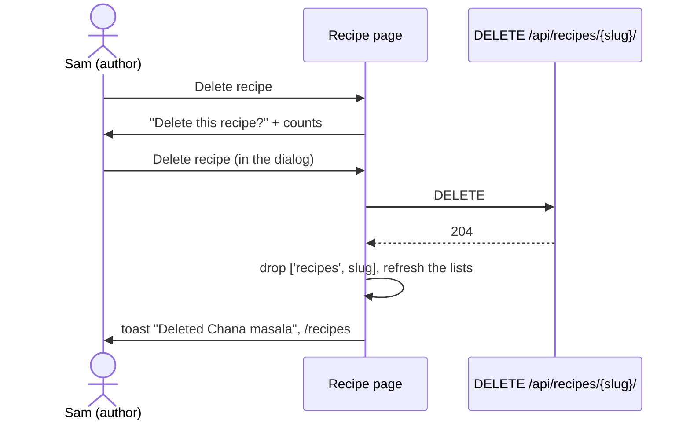

# Delete a recipe

Linear: TAS-120

## Summary

Nobody can delete a household recipe today: `recipes/<slug>/` answers only GET and PATCH. This adds `DELETE /api/recipes/<slug>/` and a "Delete recipe" button on the recipe's page, beside "Edit recipe", which opens a confirm dialog naming the recipe and how many ingredients and steps go with it. Only the author may delete a recipe, or any member of its household once the author has left it, so a recipe whose author moved out isn't stuck there for good. The rule doesn't look at visibility, so it already covers public recipes once TAS-119 (publishing) makes them.

Design: skip — the trigger is a secondary Button beside "Edit recipe", as the household page's Remove and Leave are, and the dialog is the existing ConfirmDialog, which the Dino feedback board (`docs/design/dino/feedback.dc.html`) already draws as "Delete this recipe?"; `docs/design.md`'s Button and Dialog rules decide the rest.
Components: none new or changed (Button, ConfirmDialog and toast as they are).

Evidence: feature: a walkthrough of Sam deleting a recipe, with Ben seeing no Delete button.

## Required reading

- `AGENTS.md`: hard constraints, Tests, API contract, Standards (OWASP ASVS: authorisation on every object).
- `GLOSSARY.md`: Recipe, Household recipe, Author, Member, Ingredient line, Step. Step 6 changes Household recipe.
- `backend/recipes/views.py:97-168`: `RecipeDetailView`; mirror `patch` for the refusals (403 before the lookup, 404 from a scoped queryset) and its `extend_schema`.
- `backend/recipes/models.py:224-230`: `RecipeQuerySet.editable_by`; the new `deletable_by` sits beside it. `visible_to` (l.217) shows how an `AnonymousUser` is handled. `copy_recipes_written` (l.632) is why an author who moves leaves the original behind with `created_by` still set.
- `backend/recipes/services.py:126-146`: `edit_recipe`, the shape for `delete_recipe`.
- `backend/recipes/serializers.py:246-304`: `RecipeSerializer`, which gains `can_delete`.
- `backend/households/views.py:157-171`: a `DELETE` with `responses={…, 403: None, 404: None}`.
- `backend/tests/test_editing_recipes.py`: `milos_curry`, `ben_in_milos_household`, the refusal table at l.160-194; mirror it.
- `backend/tests/test_moving_recipes.py:67-87`: `leaves`, `is_removed`, `joins_jo`, the three ways an author moves out.
- `backend/tests/test_household_privacy.py:127-131`: the outsiders' probes for `api/recipes/<slug:slug>/`.
- `frontend/src/recipes/recipe-intro.tsx:107-118`: where "Edit recipe" sits.
- `frontend/src/households/household-page.tsx:78-118, 296-335`: a ConfirmDialog with a secondary trigger, `loading` and `loadingLabel`, and the toasts after it.
- `frontend/src/households/household-api.ts:62-82` (`useRemoveMember`) and `frontend/src/recipes/recipe-form-api.ts:66-98` (`useEditRecipe`): mutation hooks with typed outcomes.
- `frontend/src/recipes/recipe-form.tsx:340-374`: what a page does with `signed-out` (asks the session again, still-signed-in toast).
- `frontend/src/recipes/recipe-page.test.tsx:445-468`: "offers to edit a private recipe, and not a public one"; mirror it. `frontend/src/households/household-page.test.tsx` for asserting toasts and a held request.
- `frontend/e2e/recipe-edit.spec.ts`: a journey with `seed()` and `accessibility.check`.
- Lessons: `confirm-dialog-trigger-shows-its-request.md` ("Deleting…"), `handle-every-documented-answer.md` (403 both ways, 404), `confirm-dialog-takes-focus-back.md` (why focus is decided below), `design-doc-wins-over-a-board.md`.

## Product behaviour

1. Only a recipe's author can delete it while they're in its household.
2. Once the author has left the household, any of its members can delete the recipe.
3. The author can delete their recipe whatever its visibility, public included once TAS-119 lands.
4. Before deleting, the dialog says the recipe, its ingredient count and step count go.

What else holds, each proved by a test below:

- "Delete recipe" shows only to someone who may delete the recipe; a catalogue recipe never shows it.
- Deleting takes you to the recipe list, with a "Deleted <title>" toast; the recipe's address then says "Recipe not found".
- Cancel deletes nothing and puts focus back on "Delete recipe".
- An author who moved out can't delete the original their old household kept.

## Technical design

- **Approach:**
  - **Queryset** (`backend/recipes/models.py`): `RecipeQuerySet.deletable_by(user)`, the one place the rule lives. The view scopes its lookup with it, and the serializer asks it for `can_delete`.
  - **Service** (`backend/recipes/services.py`): `delete_recipe(recipe)` deletes the row; the database cascades its ingredient lines, ingredient groups, steps and the cuisine, course and equipment links. Nothing else has a foreign key to `Recipe` yet.
  - **Endpoint** (`backend/recipes/views.py`): `RecipeDetailView.delete`, 204 with no body.
  - **Serializer** (`backend/recipes/serializers.py`): `RecipeSerializer.can_delete`, read-only boolean, so the page knows whether to offer Delete. The API sends nothing else about who wrote a recipe, and `/api/account/` has no id to compare with, so the server works it out from the request. `RecipeSummarySerializer` (the list) doesn't get it.
  - **Hook** (`frontend/src/recipes/recipes-api.ts`): `useDeleteRecipe(slug)`.
  - **Page** (`frontend/src/recipes/recipe-intro.tsx` and a new `recipe-delete.tsx`): the button, the dialog and what happens after each answer. The dialog's text comes from `deletionWarning(recipe)` in a new `deletion-warning.ts`.

- **API contract:**

  ```diff
    /api/recipes/{slug}/:
      get:    200 Recipe | 404
      patch:  200 Recipe | 400 | 403 | 404
  +   delete: 204 | 403 (signed out, or no household yet) | 404 (no such recipe, another household's, a catalogue
  +           recipe, or one the account may not delete)
    Recipe:
  +   can_delete: boolean   (read-only, required; also in POST /api/recipes/'s 201 and PATCH's 200)
  ```

  What the page does with each `DELETE` answer:

  | Answer | Hook returns | Page does |
  | --- | --- | --- |
  | 204 | `{ kind: 'deleted' }` | `toast.success('Deleted <title>')`, then `navigate('/recipes', { replace: true })` |
  | 404 | `{ kind: 'gone' }` | `toast.info('<title> has already been deleted, or you can\'t delete it any more.')`, then `navigate('/recipes', { replace: true })` |
  | 403 | `{ kind: 'signed-out' }` | asks the session again; signed out: `navigate('/sign-in?next=' + encodeURIComponent('/recipes/<slug>'))`; still signed in (a refused CSRF token, or the check failing): `toast.error("Couldn't delete <title>. Check your connection and try again.")` and stays |
  | anything else, or no answer | throws | `toast.error("Couldn't delete <title>. Check your connection and try again.")` and stays |

- **The rule, in the queryset:**

  ```python
  def deletable_by(self, user: User | AnonymousUser) -> RecipeQuerySet:
      """The recipes an account may delete: those of its household it wrote, and those whose author has left it.
      A catalogue recipe has no household, so nobody may."""
      household_id = user.household_id if user.is_authenticated else None
      if household_id is None:
          return self.none()
      # A deleted account leaves created_by empty; one that moved has another household (or, briefly, none).
      author_gone = Q(created_by__isnull=True) | ~Q(created_by__household_id=household_id)
      return self.filter(household_id=household_id).filter(Q(created_by=user) | author_gone)
  ```

  It doesn't look at `visibility`, so a public household recipe (TAS-119) follows the same rule. `~Q(created_by__household_id=…)` is true when the author's household is `NULL` too: Django adds the `IS NOT NULL` guard for a negated lookup on a nullable column. The tests below cover each case, so a wrong guess there fails a test.

- **`can_delete`:**

  ```python
  can_delete = serializers.SerializerMethodField(
      help_text='Whether the signed-in account may delete this recipe: its author, '
      'or any member of its household once the author has left it.'
  )

  @extend_schema_field(OpenApiTypes.BOOL)
  def get_can_delete(self, recipe: Recipe) -> bool:
      return Recipe.objects.deletable_by(self.context['request'].user).filter(pk=recipe.pk).exists()
  ```

  One query per detail response; the list doesn't pay it. `RetrieveAPIView.get` passes the request in the context already; `RecipeListView.post` (l.75) and `RecipeDetailView.patch` (l.159) build `RecipeSerializer(...)` themselves and must pass `context={'request': request}`. A missing context raises `KeyError` rather than answering `false`, so a future caller that forgets it fails its tests instead of hiding the button.

- **The hook:**

  ```ts
  export type RecipeDeletion = { kind: 'deleted' } | { kind: 'signed-out' } | { kind: 'gone' };

  export const useDeleteRecipe = (slug: string) => {
    const queryClient = useQueryClient();
    return useMutation({
      mutationFn: async (): Promise<RecipeDeletion> => {
        const { response } = await api.DELETE('/api/recipes/{slug}/', { params: { path: { slug } } });
        if (response.status === 204) {
          return { kind: 'deleted' };
        }
        // Signed out, or no household any more: the page asks the session again.
        if (response.status === 403) {
          return { kind: 'signed-out' };
        }
        // Deleted already, or the account may not delete it any more (its author came back, or it moved household).
        if (response.status === 404) {
          return { kind: 'gone' };
        }
        throw new Error(`Deleting a recipe failed with ${response.status}`);
      },
      onSuccess: async (result) => {
        if (result.kind === 'signed-out') {
          return;
        }
        // Removed rather than set to null, so the page still on screen doesn't say "Recipe not found" before it
        // navigates away; the next visit asks again.
        queryClient.removeQueries({ queryKey: ['recipes', slug], exact: true });
        await queryClient.invalidateQueries({ queryKey: ['recipes'], predicate: ({ queryKey }) => queryKey[1] !== slug });
      }
    });
  };
  ```

- **The dialog's text,** `deletionWarning(recipe: Recipe): string` in `frontend/src/recipes/deletion-warning.ts`. Ingredients counts every ingredient line, ungrouped and in groups (`[...recipe.ingredient_lines, ...recipe.ingredient_groups.flatMap((group) => group.lines)].length`); steps is `recipe.steps.length`. A count of 0 is left out, and 1 is singular:

  | Lines | Steps | Text |
  | --- | --- | --- |
  | 8 | 5 | `Chana masala, its 8 ingredients and 5 steps will be deleted for everyone in your household. You can't undo this.` |
  | 1 | 1 | `Chana masala, its 1 ingredient and 1 step will be deleted for everyone in your household. You can't undo this.` |
  | 3 | 0 | `Chana masala and its 3 ingredients will be deleted for everyone in your household. You can't undo this.` |
  | 0 | 2 | `Chana masala and its 2 steps will be deleted for everyone in your household. You can't undo this.` |
  | 0 | 0 | `Chana masala will be deleted for everyone in your household. You can't undo this.` |

- **The page:** `frontend/src/recipes/recipe-delete.tsx` exports `DeleteRecipe = ({ recipe }: { recipe: Recipe })`:

  ```tsx
  <ConfirmDialog
    trigger={
      <Button variant="secondary" loading={deleteRecipe.isPending} loadingLabel="Deleting…">
        <Trash2 aria-hidden="true" strokeWidth={2.5} />
        Delete recipe
      </Button>
    }
    title="Delete this recipe?"
    description={deletionWarning(recipe)}
    confirmLabel="Delete recipe"
    onConfirm={remove}
  />
  ```

  `remove` awaits `deleteRecipe.mutateAsync()` and does what the table above says, using `useNavigate()` and `useSession().refetch` as `recipe-form.tsx:304,365-370` does. In `recipe-intro.tsx` the "Edit recipe" link and `DeleteRecipe` share one `<div className="flex flex-wrap gap-2">`, Edit first, rendered when either shows; Edit keeps its `visibility === 'private'` condition and Delete shows when `recipe.can_delete`. The wrapper replaces Edit's `self-start`.

- **Focus:** Cancel and a failed delete leave focus where Radix puts it, on the trigger, which is still there. After a delete (or a 404) the page navigates to `/recipes`, so the trigger unmounts with its page; the app moves no focus on a route change today (as after saving the recipe form), and the toast announces the result. The page-test cases below assert the trigger has focus where it stays.



- **Blast radius:**
  - `can_delete` is a new required field of `Recipe` in `frontend/src/api/schema.d.ts`, so every `Recipe` literal in the frontend needs it: `frontend/src/test/handlers.ts` (the default recipes, `can_delete: false`), `recipe-page.test.tsx`, `edit-recipe-page.test.tsx`, `new-recipe-page.test.tsx`, `sign-in-page.test.tsx`, `recipe-gaps.test.ts` and `frontend/e2e/phone-width.spec.ts`. `pnpm lint` (tsc) finds any missed.
  - `RecipeSerializer` now needs the request in its context: the two places that build it by hand change (l.75, l.159); `backend/seed/` uses its own serializers and is unaffected. Re-run `test_private_recipes.py` and `test_editing_recipes.py`.
  - The outsiders test's `test_every_endpoint_is_probed` doesn't fail on a new method, so the probe is added by hand (step 2).
  - Nothing references `Recipe` from another area yet; TAS-123 (Save recipes to Favourites) and TAS-126 (Make a copy of a recipe) must cope with a deleted recipe when they add a foreign key to it.
- **Not changing:** editing stays open to every member (`editable_by`); the recipe list's cards get no Delete; the admin's recipe pages stay as they are.

### Steps

1. **The rule and the service.** `backend/recipes/models.py` (edit), `backend/recipes/services.py` (edit)
   Add `deletable_by` after `editable_by`, as sketched (`AnonymousUser` and `Q` are already imported). Add `delete_recipe(recipe: Recipe) -> None` after `edit_recipe`, docstring "Deletes the recipe with its ingredient lines, groups and steps. An added ingredient only it used stays, awaiting review.", body `recipe.delete()`.
   Done when: `uv run ruff check . && uv run ruff format --check .` pass.

2. **The endpoint and `can_delete`.** `backend/recipes/views.py`, `backend/recipes/serializers.py`, `backend/tests/test_household_privacy.py` (edit)
   `RecipeDetailView.delete(self, request, slug) -> Response`: refuse with `PermissionDenied` when signed out or `household_id is None`, before the lookup (copy `patch`'s comment); `recipe = get_object_or_404(Recipe.objects.deletable_by(request.user), slug=slug)`; `delete_recipe(recipe)`; `return Response(status=status.HTTP_204_NO_CONTENT)`. Its `@extend_schema`: `operation_id='recipes_destroy'`, `responses={204: None, 403: OpenApiResponse(description='Signed out, or the account has no household yet.'), 404: OpenApiResponse(description="No recipe has this slug that the account may delete: there's none, it's another household's or a catalogue recipe, or another member wrote it and is still in the household.")}`, `description="Deletes a recipe of the signed-in account's household, with its ingredients and method. Only its author may, or any member once the author has left the household."`. Add `can_delete` to `RecipeSerializer` (last in `Meta.fields`) as sketched; pass `context={'request': request}` at views.py l.75 and l.159. Add `delete('/api/recipes/{recipe}/')` to the outsiders' probes for `api/recipes/<slug:slug>/`.
   Done when: `backend/tests/test_deleting_recipes.py` (below) and `uv run pytest` pass.

3. **The contract.** `backend/schema.yml`, `frontend/src/api/schema.d.ts` (regenerated)
   `uv run --env-file .env python manage.py spectacular --file schema.yml --validate --fail-on-warn`, then `pnpm generate:api`. Add `can_delete` to every `Recipe` literal listed under Blast radius (`false` unless the test needs `true`).
   Done when: `pnpm lint` passes and `git diff backend/schema.yml` shows the `delete` operation and `can_delete` as required and read-only.

4. **The hook and the dialog's text.** `frontend/src/recipes/recipes-api.ts` (edit), `frontend/src/recipes/deletion-warning.ts` (new), `frontend/src/recipes/deletion-warning.test.ts` (new)
   `useDeleteRecipe` and `RecipeDeletion` as sketched; `deletionWarning` to the table.
   Done when: `deletion-warning.test.ts` passes.

5. **The button.** `frontend/src/recipes/recipe-delete.tsx` (new), `frontend/src/recipes/recipe-intro.tsx` (edit), `frontend/src/recipes/recipe-page.test.tsx` (edit)
   `DeleteRecipe` as sketched, with the answers in the table; place it beside Edit.
   Done when: the page tests below pass.

6. **The words.** `GLOSSARY.md` (edit)
   Household recipe's meaning becomes: "A recipe a household owns, private until it's published; any of its members can edit it, only its author can delete it (or any member once the author has left the household), and the catalogue load leaves it alone." Its "In code" becomes `` `Recipe.household`, `RecipeQuerySet.deletable_by` ``.
   Done when: the row reads so.

7. **The journey.** `frontend/e2e/recipe-delete.spec.ts` (new)
   As below.
   Done when: `pnpm test:e2e` passes.

### Tests

- `backend/tests/test_deleting_recipes.py` (new; reuse `milos_curry`, `ben_in_milos_household`, `signed_out`-style attempts from `test_editing_recipes.py` and the movers from `test_moving_recipes.py`; `remove_recipe(browser, slug)` sends `DELETE` with `browser.csrf_header()`)
  - The author deletes their recipe, asserts: 204 with an empty body, `Recipe.objects.filter(slug=slug).exists()` is `False`, and `IngredientLine`, `IngredientGroup` and `Step` rows with that recipe's id number 0 (the recipe added with one ungrouped line, one group with a line, and two steps).
  - After it's deleted, asserts: `GET /api/recipes/<slug>/` answers 404 for the author.
  - Parametrised refusals, each asserting the status and `title_of(slug) == CURRY` (the recipe is still there): signed out → 403; without the CSRF header → 403; signed up with no household yet → 403; Ben, another member, while Milo is in the household → 404; a member of another household → 404.
  - A catalogue recipe (`make_recipe(slug='apple-tart')`) can't be deleted by a signed-in member, asserts: 404 and the recipe still exists.
  - Parametrised over the author leaving, being removed and joining another household (`leaves`, `is_removed`, `joins_jo`) and the author's account being deleted (`User.objects.get(email=MILO).delete()`): Ben then deletes the original, asserts: 204 and no recipe with that slug.
  - The author who moved can't delete the original: Milo leaves, then `DELETE` on the original's slug, asserts: 404, the original still exists in Ben's household and Milo's copy (a different slug) still exists.
  - An added ingredient only the deleted recipe used stays, asserts: the `Ingredient` with that name exists with `status == 'awaiting_review'`.
  - Parametrised `can_delete` on `GET /api/recipes/<slug>/`: Milo on his own recipe → `True`; Ben while Milo is in the household → `False`; Ben after Milo left → `True`; a member on a catalogue recipe → `False`; signed out on a catalogue recipe → `False`.
  - `can_delete` in the write answers, asserts: Milo's `POST /api/recipes/` answer has `can_delete is True`; Ben's `PATCH` of Milo's recipe answers `can_delete is False`.
- `backend/tests/test_household_privacy.py`
  - The new `DELETE` probe, asserts (through the existing `test_no_endpoint_shows_or_changes_a_household_for_an_outsider`): the Quillfeathers' recipe is still there after an outsider's `DELETE`.
- `frontend/src/recipes/deletion-warning.test.ts` (new)
  - `it.each` over the five rows of the table (lines split across `ingredient_lines` and a group for the 8-line row), asserts: the exact string in the table.
- `frontend/src/recipes/recipe-page.test.tsx` (edit; a private `Our shakshuka` at `/recipes/shakshuka-k7m2qx` with `can_delete: true`, 2 ingredient lines and 2 steps, and a `DELETE` handler that records each request's path)
  - Offers Delete only to who may delete, asserts: the "Delete recipe" button is there for `can_delete: true`; after navigating to the same recipe with `can_delete: false`, and `queryClient.isFetching()` is 0, there's no "Delete recipe" button but "Edit recipe" is still there.
  - Opening the dialog, asserts: an `alertdialog` named "Delete this recipe?" with the description "Our shakshuka, its 2 ingredients and 2 steps will be deleted for everyone in your household. You can't undo this.", and buttons "Delete recipe" and "Cancel" within it.
  - Cancel, asserts: no `DELETE` was sent, the dialog is gone and the "Delete recipe" trigger has focus.
  - Deleting, asserts: the recorded `DELETE` paths are `['/api/recipes/shakshuka-k7m2qx/']`, `router.state.location.pathname` is `/recipes` and `toast.success` was called with `Deleted Our shakshuka`.
  - While the request is held, asserts: the trigger's accessible name is "Deleting…".
  - A 404 answer, asserts: `toast.info` called with "Our shakshuka has already been deleted, or you can't delete it any more." and the pathname is `/recipes`.
  - A 403 answer with the session then signed out, asserts: the location is `/sign-in?next=%2Frecipes%2Fshakshuka-k7m2qx`.
  - `it.each` over a 403 with the session still signed in, a 500 and `HttpResponse.error()`, asserts: `toast.error` called with "Couldn't delete Our shakshuka. Check your connection and try again.", the heading "Our shakshuka" is still there and the "Delete recipe" trigger has focus.
- `frontend/e2e/recipe-delete.spec.ts` (new)
  - Seeds inline (one spec uses it, so not a named setup): Sam, who wrote "Chana masala" (cuisine Indian, `ingredient_lines: [{ amount: 1, ingredient: 'onion' }, { amount: 2, ingredient: 'garlic', note: 'cloves' }]`, `steps: ['Fry the onion and garlic until soft.']`), and Ben in the same household. Ben opens it, asserts: "Edit recipe" is visible and "Delete recipe" has count 0. Sam opens it and presses "Delete recipe", asserts: the dialog says "Chana masala, its 2 ingredients and 1 step will be deleted for everyone in your household. You can't undo this." and `accessibility.check` passes with it open. Sam confirms, asserts: the URL ends `/recipes`, the "Deleted Chana masala" toast is visible and no "Chana masala" link is in the list. Ben reloads its address, asserts: the heading "Recipe not found".
- Checks: `pnpm lint`, `pnpm test`, `uv run ruff check . && uv run ruff format --check .` and `uv run pytest` (in `backend/`), `pnpm test:e2e`, and the API contract regenerated with no diff left.

## Decisions

- Any member may delete a household recipe once its author has left the household (moved, removed, joined another, or their account is gone); while the author is a member only they may, because requirement 17 keeps the original in the household when its author moves and strict author-only would make it undeletable. Asked: who deletes a recipe whose author has left? → Any member once the author's gone.
- The dialog gives the recipe's own numbers: its ingredient lines and steps, leaving out a count of 0, because saves, notes and the shopping list don't exist yet and the saves count comes with TAS-123. Asked: which real numbers does the dialog give? → Its ingredients and steps.
- The rule is written now without looking at visibility, so the author can delete a public recipe once TAS-119 makes one; the public case's test comes with TAS-119. Asked: how to meet "the author can delete a public recipe" before publishing exists? → Rule now, test with TAS-119.
- "Delete recipe" is a secondary button with a bin icon beside "Edit recipe", with no design round, because the household page's Remove and Leave are secondary triggers for a danger dialog and `docs/design.md` decides the rest. Asked: where does Delete go, and does it need design first? → Beside Edit, no design.
- The page learns who may delete from a server-worked `can_delete`, rather than an author id compared on the client, because the API exposes no account id and the rule (author gone) needs the author's household, which the client can't see. One extra query per recipe page, not per list. (agent)
- The dialog's title is "Delete this recipe?" as the feedback board draws it, its description names the recipe, and its confirm says "Delete recipe" as `docs/design.md` (Dialog) asks; the board's description mentions notes and the shopping list, which don't exist yet, so it's left out. (agent)
- A 404 from `DELETE` goes to the list like a success, with an info toast, rather than refreshing the page in place, because the trigger (and maybe the whole recipe) is gone either way and the list is where focus and the toast make sense; the list is refreshed, so a recipe that still exists shows there. (agent)
- A non-author member gets 404, not 403, as `patch` gives 404 for a recipe the account can't edit: it says nothing a refusal would. (agent)
- After a delete, focus isn't moved by hand: the page navigates, as saving the recipe form does, and the toast announces it. (agent)

## Assumptions

- A non-author member, while the author is in the household, sees no Delete button and gets 404 from the API (triage's question 3, not asked: my suggestion). Confirm with: Milo, at spec approval.
- An added ingredient awaiting review that only the deleted recipe used stays in the database, offered to nobody, until staff review it; cleaning such ingredients up is not this issue's. Confirm with: Milo, at spec approval.
- Deleting is immediate and permanent, with no undo or bin: `docs/design.md` principle 3 offers Undo "wherever the action can be undone", and the confirm dialog is the Dialog rule's answer for what can't. Confirm with: Milo, at spec approval.
- Who may delete a public household recipe whose author has left is TAS-119's to decide; this rule lets any member, as for a private one. Confirm with: Milo, when TAS-119 is specced.

## Out of scope

- The number of people who saved the recipe in the dialog, and "No longer available" for them (TAS-123 (Save recipes to Favourites)).
- A test of deleting a public recipe (TAS-119 (Make your recipe public), once one can exist).
- Deleting from the recipe list's cards, the admin, or several at once.
- Undo, or a bin to restore from.
- Removing added ingredients nothing uses any more.
- Deleting an account and its recipes (`docs/architecture.md`, planned).

## Validation criteria

- [ ] `pnpm lint` and `pnpm test` pass.
- [ ] `uv run ruff check . && uv run ruff format --check .` and `uv run pytest` pass in `backend/`.
- [ ] `backend/schema.yml` and `frontend/src/api/schema.d.ts` are regenerated and CI's API contract job passes.
- [ ] `pnpm test:e2e` passes, including `recipe-delete.spec.ts` with axe on the open dialog.
- [ ] On the preview, behaviours 1, 2 and 4 hold: Sam deletes, Ben sees no Delete.
- Evidence: walkthrough video of Sam deleting "Chana masala" from its page and Ben's view without Delete.
