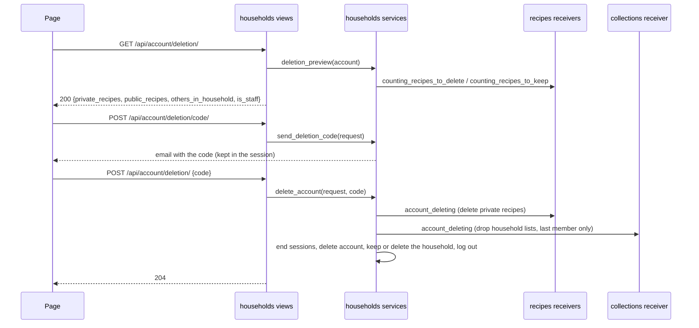

# Delete your account

Linear: TAS-134

## Summary

Nothing deletes an account today, though the privacy page already promises it (`frontend/src/app/privacy-page.tsx:62-66`, "Deleting your account removes…") and `docs/architecture.md:66` lists it as _planned_. This lets a person delete their account from the account page after entering a fresh code from their email. It removes their email address, name, sessions, Favourites, personal lists and the private recipes they wrote; the public recipes they wrote stay, credited "by a former member", so saved links keep working. Their household carries on if anyone is left in it; a last member's household keeps only its public recipes. Staff can't delete themselves here.

The work ships in two parts, each merging to `main` alone, in order:

- **Part 1 (this issue and branch): the API.** What deleting would remove (`GET /api/account/deletion/`), a deletion code by email (`POST /api/account/deletion/code/`), the deletion itself (`POST /api/account/deletion/`), the clean-up in recipes and lists, and "a former member" as the author of a public recipe whose author is gone. Nothing changes on screen but that credit, which the recipe page, card, lists and copies already print from `author`.
- **Part 2 (a sub-issue filed on approval): the account page.** A "Delete your account" section, and a dialog that shows the real numbers, sends the code and deletes.

Design: needed — part 2 adds a section to the account page and a dialog with a code step, which no board draws; part 1 has nothing to draw ("by a former member" is the existing "by <name>" line with other words).
Components: ConfirmDialog (changed: a body of several lines, a Send code step, a Code field before its danger button, and a loading and an error state). Field, Input, Button, Loading and ErrorWithRetry are reused as they are.

Evidence: part 1: "No visible change." apart from the credit, with the API tests' names; part 2: a walkthrough of Sam deleting their account from the account page, with the code from the email, and Jo then seeing "Sam's dal" in Favourites "by a former member".

## Required reading

- `AGENTS.md`: hard constraints, Domain areas (signals from `households`), Tests, API contract, Standards (OWASP ASVS: re-authentication before a destructive change; UK GDPR: right to erasure).
- `GLOSSARY.md`: Account, Author, Household, Member, Public recipe, Private recipe, Household recipe. Part 1 changes Account and Household and adds Former member and Former household.
- `backend/households/services.py:158-173` (`leave_household`): the lock order (household first, then the account) and the empty-household delete to mirror. `:248-253` (`cancel_current_invite`). `:281-283` (`recipes_to_copy`): how households sums a counting signal. `:343-352` (`seconds_until_allowed`).
- `backend/households/signals.py`: `member_moved` and `counting_recipes_to_copy`, the pattern for the three new signals.
- `backend/households/views.py:71-94` (`CurrentAccountView`), `:222-225` (`DeadInviteError`, the shape of a 409), `:255-261` (`RequestSignInCodeView`, how sign-in's code limit answers).
- `backend/households/adapter.py:212-217`: `send_mail` stores a test account's code instead of emailing it, so the e2e spec can read the deletion code as it reads a sign-in code.
- `backend/recipes/models.py:854-870`: the `member_moved` and `counting_recipes_to_copy` receivers; the new receivers sit beside them. `:313-321` (`deletable_by`), unchanged.
- `backend/recipes/services.py:487-498` (`delete_recipe`, `_delete_photo_unless_used`): deleting a recipe deletes its uploaded photo unless another recipe uses it.
- `backend/recipes/serializers.py:294-299` and `backend/recipe_collections/serializers.py:94-99`: the two `get_author`s.
- `backend/recipe_collections/models.py:107-114`: the collections receiver to mirror.
- `backend/tests/test_accounts.py:30-70, 183-310`: `BrowserClient`, `emailed_code`, `ask_for_codes` and the code tests (10 minutes, 5 wrong tries, 3 codes in 10 minutes) to mirror. `backend/tests/test_household.py:19-58` (helpers) and `backend/tests/test_household_privacy.py:62-130` (`ENDPOINTS`).
- Part 2: `frontend/src/households/account-page.tsx`, `download-api.ts`, `session-api.ts`, `sign-in-page.tsx:19-40, 200-240` (the code step and its copy), `frontend/src/dino/confirm-dialog.tsx`, `docs/design.md:184` (Dialog: "the danger button names the action ("Delete account")").
- Lessons: `a-service-refusal-without-a-field-needs-non-field-errors.md`, `admin-user-fixture-has-a-password.md`, `handle-every-documented-answer.md`, `confirm-dialog-trigger-shows-its-request.md`, `confirm-dialog-takes-focus-back.md` (part 2), `design-doc-wins-over-a-board.md` (part 2), `factory-runs-make-baselines-in-place.md` (part 2), `spec-questions-hold-for-every-earlier-answer.md`.

## Product behaviour

**Part 1: the API**

1. A signed-in account learns how many private recipes deleting deletes and how many public ones stay.
2. Asking for a deletion code emails a 6-digit code that works for 10 minutes.
3. Deletion codes share sign-in's limit: at most 3 codes per address in 10 minutes.
4. A wrong, expired or used code deletes nothing, and the fifth wrong try stops it.
5. The right code deletes the account and signs it out on every browser.
6. Deleting removes the email address, name, sessions, Favourites, personal lists and private recipes written.
7. Public recipes the account wrote stay, credited "by a former member" everywhere an author shows.
8. When others remain, the household carries on with its name, lists and their recipes.
9. A last member's household keeps only its public recipes, renamed "A former household".
10. A last member's household with no public recipes is deleted, as leaving deletes one.
11. A staff account can't ask for a deletion code or delete itself.
12. A visitor who isn't signed in can't see, ask for a code or delete.
13. An account that signs in with Google deletes the same way, the code going to its email.

**Part 2: the account page**

14. The account page has a "Delete your account" section with a "Delete account" button.
15. The dialog says what's deleted and kept, with real numbers, and that backups keep 30 days.
16. The dialog emails a code and asks for it before deleting.
17. A wrong or stopped code, or too many codes, is explained in the dialog.
18. Once deleted, you're signed out on the home page and told it's done.
19. A staff account's dialog says why it can't be deleted, with no way to delete.

## Technical design

### How it works today

- An account is `households.User` (`backend/households/models.py:68`). Deleting the row (only the admin or a test does today) cascades its allauth `EmailAddress`, `SocialAccount` and `Authenticator` rows and its personal lists (`RecipeList.owner`, CASCADE, with their `SavedRecipe` rows), and empties `Recipe.created_by` and `Report.reporter` (SET_NULL). It doesn't touch the account's sessions, its private recipes or its household. `User.household` is PROTECT, so a household with members can't be deleted.
- `Recipe.household` is CASCADE (`backend/recipes/models.py:328-334`) and `household IS NULL` means catalogue (`catalogue()`, `:185`), so deleting an emptied household deletes every recipe in it, public ones too.
- A public household recipe's `author` is `created_by.name`, or `null` when `created_by` is empty (`backend/recipes/serializers.py:295-299`, `backend/recipe_collections/serializers.py:95-99`); the frontend prints "by <author>" only when it isn't null (`frontend/src/recipes/recipe-card.tsx:63`, `recipe-intro.tsx:119-139`, `recipe-report.tsx:190`), so today a deleted author's public recipe reads like a catalogue one.
- Sessions are Django's database sessions (`django_session`), 30 days from the last request; nothing finds an account's sessions.
- allauth's headless reauthentication is password-only (`allauth/headless/account/views.py:578`), and no account has a password, so it can't be reused. allauth's login-by-code keeps its code in the session (`ACCOUNT_LOGIN_BY_CODE_TIMEOUT` 600 s, `ACCOUNT_LOGIN_BY_CODE_MAX_ATTEMPTS` 5, `ALLAUTH_USER_CODE_FORMAT` 6 digits, `backend/config/settings.py:167-177`).

### Part 1: the API



#### API contract

```diff
+ GET  /api/account/deletion/       200 AccountDeletion | 403
+ POST /api/account/deletion/code/  (no body) 204 | 403 | 429 (Retry-After)
+ POST /api/account/deletion/       AccountDeletionCode 204 | 400 | 403 | 409
  RecipeSummary.author, Recipe.author, Recipe.adapted_from.author, ListedRecipe.author:
-   null for a private or catalogue recipe, or a public one whose author is gone
+   "a former member" for a public household recipe whose author deleted their account
```

```yaml
AccountDeletion:          # all required
  private_recipes: int    # private recipes deleting now would delete: those the account wrote in its household,
                          # or every private recipe in it when it's the household's last member; 0 with no household
  public_recipes: int     # public recipes that stay, credited "a former member": those it wrote in its household,
                          # or every public recipe in it when it's the last member; 0 with no household
  others_in_household: int  # members who stay; 0 for a last member or an account with no household
  is_staff: bool          # a staff account can't delete itself here
AccountDeletionCode:
  code: string            # required
```

- `GET /api/account/deletion/` — `operation_id='account_deletion_retrieve'`. 403 when not signed in.
- `POST /api/account/deletion/code/` — `operation_id='account_deletion_code_create'`, `request=None`. Emails a new code and keeps it in this session, replacing any earlier one; answers 204 with no body. 403 when not signed in, or for staff with `{"detail": "Staff accounts can't be deleted here. Ask another staff member to take your staff access away first."}`. 429 when the address has had 3 codes (sign-in's or deletion's) in 10 minutes, or the IP 20 in a minute: DRF's `Throttled(wait=seconds)`, so the answer carries `Retry-After` with `seconds_until_allowed(request, 'request_login_code', key=email)`.
- `POST /api/account/deletion/` — `operation_id='account_deletion_create'`. 204 with no body once the account is deleted; this browser's session is ended (`logout`) and every other session of the account deleted. 400 `{"code": ["This field is required."]}` with no code (not counted as a try), and `{"code": ["That code isn't right. Check the email and try again."]}` for a wrong code with tries left. 403 when not signed in, or for staff with the same detail as above (checked before the code, so staff never spend one). 409 `{"detail": "That code has stopped working. Send a new code."}` when this session has no code (never asked, already used, or asked while signed in as another account), the code is over 10 minutes old, or this was the fifth wrong try. 

#### households (`backend/households/`)

- **`signals.py`** gains three signals, each sent only for an account with a household, with a line each on what it's sent with and answered with, as the two there are:
  - `counting_recipes_to_delete`: sent with `account` and `last` (whether it's its household's last member); answered with how many private recipes deleting it now would delete.
  - `counting_recipes_to_keep`: sent with `account` and `last`; answered with how many public recipes would stay in its household.
  - `account_deleting`: sent with `account` and `last`, inside the deletion's transaction holding the household's and account's locks, before the account row is deleted; receivers delete what goes with it that deleting the row doesn't cascade to. The module docstring changes to say it's how a move or a deletion reaches the areas that keep something of the account's.
- **`services.py`**:

  ```python
  FORMER_HOUSEHOLD = 'A former household'
  # The session key holding a deletion code: {'account': pk, 'code': str, 'sent_at': time.time(), 'attempts': int}.
  DELETION_CODE = 'account_deletion_code'

  @dataclass(frozen=True)
  class AccountDeletion:
      private_recipes: int
      public_recipes: int
      others_in_household: int
      is_staff: bool

  class WrongDeletionCodeError(Exception): ...      # wrong, with tries left
  class DeletionCodeStoppedError(Exception): ...    # none, used, expired, another account's or the 5th wrong try

  def deletion_preview(account: User) -> AccountDeletion: ...
  def send_deletion_code(request: HttpRequest) -> bool: ...   # False when the limit refuses; nothing sent
  def delete_account(request: HttpRequest, code: str) -> None: ...
  def end_sessions_of(account: User) -> None: ...
  ```

  - `deletion_preview`: `others` counts the household's other members (0 with no household); `last = household_id is not None and others == 0`; the two counts are sums over `counting_recipes_to_delete` and `counting_recipes_to_keep`, as `recipes_to_copy` sums (`:281-283`), and 0 with no household; `is_staff = account.is_staff`.
  - `send_deletion_code`: `allauth.core.ratelimit.consume(request, action='request_login_code', key=account.email.lower())`, sign-in's own limit and key (`allauth/account/forms.py:766`), so deletion codes and sign-in codes share one count; when refused, returns `False`. Otherwise makes a code with `get_adapter(request).generate_login_code()` (`allauth.account.adapter`), stores the state above in `request.session[DELETION_CODE]`, and sends it with `get_adapter(request).send_mail('households/email/deletion_code', account.email, {'code': code})`, so a test account's code is stored for the e2e tests as a sign-in code is. A send failure isn't caught, as sign-in's isn't.
  - `delete_account`: reads `request.session.get(DELETION_CODE)`. None, another account's (`state['account'] != request.user.pk`) or older than `settings.ACCOUNT_LOGIN_BY_CODE_TIMEOUT` seconds by `time.time()`: pops it and raises `DeletionCodeStoppedError`. A code that doesn't match (`hmac.compare_digest`): adds one to `attempts`; at `settings.ACCOUNT_LOGIN_BY_CODE_MAX_ATTEMPTS` pops it and raises `DeletionCodeStoppedError`, else saves it back and raises `WrongDeletionCodeError`. The right code: pops it (spent), then in one transaction:
    1. Locks the account's household (`Household.objects.select_for_update().filter(pk=account.household_id).first()`, none for an account with no household), then the account (`User.objects.select_for_update().get(pk=…)`). A `User.DoesNotExist` here means a second press already deleted it: return. An account removed while this waited is alone in its new household, which nobody can join, so it carries on with that one, as `join_household` does (`:323-324`).
    2. `last` as above, for the account's household as now saved.
    3. With a household: `kept` = the sum over `counting_recipes_to_keep`; then `account_deleting.send(sender=User, account=account, last=last)`.
    4. `end_sessions_of(account)`; deletes the account's `StoredSignInCode` row (`email=account.email.lower()`, test accounts only); `account.delete()`.
    5. When `last`: with `kept == 0`, deletes the household (its invites and any household lists cascade); otherwise renames it `FORMER_HOUSEHOLD` and calls `cancel_current_invite(household_id)`.

    After the transaction, `logout(request)`, which flushes this session (its row is already gone) and gives the browser a new, signed-out one. The session must be flushed, not left: with `SESSION_SAVE_EVERY_REQUEST`, saving a session whose row was deleted fails the response.
  - `end_sessions_of`: deletes every `django.contrib.sessions.models.Session` whose decoded `django.contrib.auth.SESSION_KEY` is `str(account.pk)`, expired ones included, reading the table with `.iterator()`. One pass over every session; fine at Tastebook's size, and the only way to find an account's sessions without adding allauth's `usersessions`.
- **`templates/households/email/deletion_code_subject.txt`** (new): `Your code to delete your Tastebook account is {{ code }}`.
- **`templates/households/email/deletion_code_message.txt`** (new):

  ```text
  Here's your code to delete your Tastebook account:

  {{ code }}

  It works once, for the next 10 minutes, in the browser that asked for it.

  If you didn't ask for it, don't share it with anyone. Nobody can delete your account without it.
  ```
- **`serializers.py`**: `AccountDeletionSerializer` (the four fields, each with the `help_text` in the contract above) and `AccountDeletionCodeSerializer` (`code = serializers.CharField()`).
- **`views.py`**: `STAFF_REFUSED`, `WRONG_DELETION_CODE` and the 409's text as module constants with the copy above, and:
  - `DeletionCodeStoppedError(APIException)`: 409, `default_detail` the stopped text, `default_code='deletion_code_stopped'`, as `DeadInviteError`.
  - `AccountDeletionView(APIView)`: `get` (raises `NotAuthenticated` when not signed in; answers `AccountDeletionSerializer(deletion_preview(request.user))`) and `post` (not signed in: `NotAuthenticated`; staff: `PermissionDenied(STAFF_REFUSED)`; validates `AccountDeletionCodeSerializer`; maps `WrongDeletionCodeError` to `ValidationError({'code': [WRONG_DELETION_CODE]})` and `DeletionCodeStoppedError` to the 409; answers `Response(status=204)`).
  - `DeletionCodeView(APIView)`: `post` (not signed in: `NotAuthenticated`; staff: `PermissionDenied(STAFF_REFUSED)`; `send_deletion_code(request)` False: `Throttled(wait=seconds_until_allowed(request, 'request_login_code', key=request.user.email.lower()))`; else 204).
  - Each with `extend_schema` (operation ids and responses as in the contract, `description` saying what's deleted and kept and the 10 minutes).
- **`backend/config/urls.py`**: `path('api/account/deletion/', AccountDeletionView.as_view(), name='account-deletion')` and `path('api/account/deletion/code/', DeletionCodeView.as_view(), name='account-deletion-code')`, after `api/account/download/`.

#### recipes (`backend/recipes/`)

- **`models.py`**, beside the two receivers there (`:854-870`), importing the three signals and `delete_photo` from `recipes.photo_store` (which imports nothing of `models`):

  ```python
  def _going_with(account: User, last: bool) -> RecipeQuerySet:
      """The recipes of the account's household that its deletion decides on: those it wrote, or all of them when
      nobody else is left in it."""
      recipes = Recipe.objects.filter(household_id=account.household_id)
      return recipes if last else recipes.filter(created_by=account)

  @receiver(counting_recipes_to_delete, dispatch_uid='recipes-count-recipes-to-delete')
  def count_recipes_to_delete(sender: type[User], account: User, last: bool, **kwargs: Any) -> int:
      return _going_with(account, last).private().count()

  @receiver(counting_recipes_to_keep, dispatch_uid='recipes-count-recipes-to-keep')
  def count_recipes_to_keep(sender: type[User], account: User, last: bool, **kwargs: Any) -> int:
      return _going_with(account, last).public().count()

  @receiver(account_deleting, dispatch_uid='recipes-delete-private-recipes')
  def delete_private_recipes(sender: type[User], account: User, last: bool, **kwargs: Any) -> None:
      """Deletes the private recipes that go with the account, with their uploaded photos once nothing else uses
      them. Its public ones stay; deleting the account empties their author."""
  ```

  `delete_private_recipes` reads the private recipes' non-empty `photo_url`s, deletes the recipes (their share links, reports, lines, groups and steps cascade; copies' `adapted_from` and saves' `recipe` go empty, as deleting one recipe does), then for each address `transaction.on_commit` deletes it from the store unless a recipe still uses it, as `_delete_photo_unless_used` (`services.py:495-498`) does; that's this logic's second copy, so it's written again, not shared.
- **`services.py`**: `FORMER_MEMBER = 'a former member'`, beside `PUBLIC_A_DAY`, which collections already reads from here.
- **`serializers.py`** `RecipeSummarySerializer.get_author` (`:295-299`): private or catalogue still `None`; `created_by_id is None` answers `services.FORMER_MEMBER`; otherwise the name. `created_by_id`, not `created_by`, so it costs no query. The field's `help_text` adds: `"a former member" once its author has deleted their account`. `OriginalRecipeSerializer.author` and `adapted_from` follow it with no change of their own, so a public copy reads "Adapted from <title> by a former member".

#### collections (`backend/recipe_collections/`)

- **`models.py`**: a receiver beside `drop_unseen_saves`:

  ```python
  @receiver(account_deleting, dispatch_uid='collections-drop-household-lists')
  def drop_household_lists(sender: type[User], account: User, last: bool, **kwargs: Any) -> None:
      """A last member's household keeps no lists, as nobody is left to see them. Its personal lists go with the
      account."""
  ```

  When `last`, deletes `RecipeList.objects.filter(household_id=account.household_id)`.
- **`serializers.py`** `ListedRecipeSerializer.get_author` (`:95-99`): the same change, with `recipe_services.FORMER_MEMBER`.

#### Generated and docs

- `backend/schema.yml` and `frontend/src/api/schema.d.ts`, regenerated (`AGENTS.md`, API contract). No other frontend change in part 1: `author` stays `string | null`.
- `GLOSSARY.md`: Account adds "Deleting it, from the account page with a code from its email, deletes its name, email address, sessions, Favourites, personal lists and the private recipes it wrote; staff can't." (`delete_account()`). Author adds "a former member" once the account is deleted. Household adds that a last member's deletion keeps it, renamed "A former household", only while it holds public recipes. New rows: **Former member** (`recipes`): how a public recipe credits an author who deleted their account, "by a former member" (`FORMER_MEMBER`); **Former household** (`households`): a household whose last member deleted their account, kept, renamed and with no members, lists, invite or private recipes, only for its public recipes (`FORMER_HOUSEHOLD`).
- `docs/architecture.md:66`: drop _planned_ and say what deleting does, as Behaviours 5-10 say; `:61` (sessions): "deleting an account deletes its sessions".

### Part 2: the account page

Part 2 waits on the approved design; where its boards draw something this section doesn't, `docs/design.md` and the boards decide, and the part's PR lists each difference (lesson `design-doc-wins-over-a-board.md`). The copy below stands unless the design changes it.

- **`frontend/src/households/deletion-api.ts`** (new), mirroring `download-api.ts` and `session-api.ts`:
  - `DELETION_KEY = ['households', 'account-deletion']`; `useAccountDeletion(open: boolean)`: a query of `GET /api/account/deletion/`, `enabled: open`, so the numbers are fetched when the dialog opens.
  - `useSendDeletionCode()`: a mutation of `POST /api/account/deletion/code/` resolving `{ kind: 'sent' } | { kind: 'too-many'; retryAfterSeconds: number | undefined }` (429, `Retry-After`); a 403 invalidates `SESSION_KEY` and throws; anything else throws.
  - `useDeleteAccount()`: a mutation of `POST /api/account/deletion/` resolving `{ kind: 'deleted' } | { kind: 'wrong' } | { kind: 'stopped' }` (204, 400, 409); on `deleted` it sets `SESSION_KEY` to `null` and calls `forgetSignedInData`; a 403 invalidates `SESSION_KEY` and throws; anything else throws.
- **`frontend/src/households/account-page.tsx`**: a fourth section after "Your data", `<section aria-labelledby="account-delete">` with `<h2 id="account-delete">Delete your account</h2>`, the paragraph "Delete your account and everything only you can see. Public recipes you wrote stay, credited to “a former member”." and a danger `Button` "Delete account" opening the dialog. The dialog:
  - Title "Delete your account?". While loading, `Loading` "Checking what deleting removes…"; on error, `ErrorWithRetry` "Couldn't reach Tastebook" / "Check your connection and try again.".
  - Staff (`is_staff`): "Staff accounts can't be deleted here. Ask another staff member to take your staff access away first." and only a "Close" button.
  - Otherwise, one line each, a line left out when its number is 0:
    - "Your name, email address, Favourites and personal lists will be deleted, and you'll be signed out everywhere."
    - With others in the household: "The {n} private recipe(s) you wrote will be deleted. Leave your household first if you want it to keep them." As its last member: "Your household's {n} private recipe(s) will be deleted, as nobody else is in it."
    - With others: "The {n} public recipe(s) you wrote stay, credited to “a former member”, so links to them keep working." As its last member: "The {n} public recipe(s) in your household stay, credited to “a former member”, so links to them keep working."
    - "Nightly backups keep a copy for up to 30 days."
    - Buttons "Cancel" and "Send code" (loading "Sending…").
  - After sending: "We sent a 6-digit code to {email}. It works for 10 minutes." A `Field` "Code" (`inputMode="numeric"`, `autoComplete="one-time-code"`, `maxLength={6}`), focused; buttons "Cancel", "Send a new code" (secondary, loading "Sending…") and the danger "Delete account" (loading "Deleting…").
  - Errors on the Code field, with sign-in's words: not 6 digits, not sent: "Enter the 6-digit code from the email, like 123456."; 400: "That code isn't right. Check the email and try again."; 409: "That code has stopped working. Send a new code."; 429 on either send: "You've asked for too many codes. Try again in {n} minutes." (sign-in's `tooManyCodes`); a thrown request: toast "Couldn't delete your account. Check your connection and try again." or "Couldn't send the code. Check your connection and try again.".
  - Deleted: navigate to `/` and `toast.success('Your account is deleted.')`.
- **`frontend/src/dino/confirm-dialog.tsx`** changes as the design draws (or a new Dino dialog if the design names one), with stories for each state and their baselines.
- **`frontend/src/app/privacy-page.tsx`**: "Your choices" gains "Delete your account on your account page." with the link, as the item above it has.

## Decisions

- Two parts: the API first, then the page, because together it's about 25 files (endpoints, services, receivers, email, schema and tests; the dialog with a code step, its stories and baselines, the page, its tests and an e2e spec), and part 1 can merge while part 2 is designed. Asked: one PR or the API first? → Split: API, then the page.
- A last member's public recipes stay, and their household with them, emptied and renamed "A former household", because deleting the household would cascade to them and break saved links and copies' credits, and `household IS NULL` already means catalogue, so moving them out isn't an option. Its private recipes, lists and invite go; a household with no public recipes is deleted, as leaving deletes one. Asked: a last member's public recipes? → Keep them, household emptied.
- The private recipes you wrote are deleted even when others stay in the household, because deleting isn't leaving and the privacy page already promises it; the dialog says to leave first to keep them. Others' private recipes stay. Asked: your private recipes when others stay? → Delete them, as sliced.
- Staff can't delete themselves here: the endpoints answer 403 and the dialog explains, because an email code alone would let anyone with a staff member's inbox delete an account that holds the admin's history. Asked: may staff delete themselves? → Refuse while staff.
- No email to the other members, because the Members list already shows who's gone and another message about a person who asked to be forgotten is the wrong way round. Asked: email the household? → No email.
- The code is kept in the session, not a table, because allauth's own sign-in code is, it ties the code to the browser that asked (someone with the inbox alone can't use it), and it needs no migration (agent).
- Deletion codes share sign-in's limit (`request_login_code`, keyed by the address), because both email a code to the same inbox and a separate count would double what one address can be sent (agent).
- A deletion code follows sign-in's rules: 6 digits, 10 minutes, the fifth wrong try stops it, a new code replaces the last, so the API, the email and the page's error words match sign-in's (agent).
- The account's sessions are found by decoding every session, because Django's database sessions don't record their account and allauth's `usersessions` would add an app, middleware and a migration for this one use (agent).
- The API sends "a former member" as `author`, rather than a flag the frontend reads, because every place that prints "by <author>" (card, page, saved lists, report dialog, a copy's "Adapted from") then shows it with no frontend change, and catalogue recipes keep `null` (agent).
- The emptied household is renamed, because its name is often its last member's ("Sam's household") and that's personal data the deletion should take (agent).
- Three signals from `households` (counting what's deleted, counting what's kept, and acting), because `households` depends on no other area (`AGENTS.md`), and each answers one thing, as `counting_recipes_to_copy` and `member_moved` do (agent).
- No seed change: the deletion endpoint makes a former member's recipe and a former household in one request from any seeded account, as part 2's e2e spec does (agent).

## Blast radius

- `get_author` in both serializers: every list, recipe, saved list and copy response. Re-check `test_recipes.py`, `test_catalogue.py`, `test_copying_recipes.py`, `test_seed.py` (catalogue authors stay `null`), `test_saving_recipes.py:374` and `test_reviewing_reports.py:249` (which empty `created_by` on purpose), and the list's query count (`test_recipes.py:268`).
- `households/signals.py`: the new receivers run only on deletion; `member_moved` and `counting_recipes_to_copy` are untouched.
- `test_household_privacy.py`'s `test_every_endpoint_is_probed` fails until both new routes are in `ENDPOINTS`.
- Sign-in's code limit: a deletion code now counts towards it. `test_accounts.py`'s limit tests don't ask for deletion codes, so they keep passing.
- The frontend's typed fixtures don't change (`author` stays `string | null`).

## Out of scope

- Downloading everything first (TAS-133, shipped): the account page already has it above.
- Who may edit or delete a former member's public recipe: `deletable_by` already lets any remaining member delete it and nobody edit it (`recipes/models.py:313-321`); a former household's public recipes are staff's to remove in the admin.
- Deleting expired sessions in general, and the sign-in limits' cache rows (cleared every night, `docs/architecture.md`).
- Deleting an account from the admin, or a staff account in any way; making the account undeletable for a while ("grace period").
- Removing a person from backups before their 30 days are up.
- Emailing the person that their account was deleted, or the household that they've gone.
- The `Recipe.created_by` `help_text` ("Empty for a catalogue recipe"), which would need a migration for words only.

## Steps

### Part 1 (this branch)

1. **Signals.** `backend/households/signals.py` (edit). Add the three signals and the docstring. Done when: `uv run lint-imports` passes.
2. **Recipes' receivers and the credit.** `backend/recipes/models.py`, `services.py`, `serializers.py` (edit). Add `_going_with`, the three receivers, `FORMER_MEMBER` and the `get_author` change. Done when: a test that deletes an author's account with `User.delete()` sees `"a former member"` on the recipe and `null` on a catalogue recipe.
3. **Collections' receiver and credit.** `backend/recipe_collections/models.py`, `serializers.py` (edit). Done when: a saved list's public recipe by a deleted author reads `"a former member"`.
4. **Services.** `backend/households/services.py` (edit), the two templates (new). `deletion_preview`, `send_deletion_code`, `delete_account`, `end_sessions_of`. Done when: the service-level cases in Tests pass through the views in step 5.
5. **Views and routes.** `backend/households/serializers.py`, `views.py`, `backend/config/urls.py` (edit). Done when: `backend/tests/test_deleting_accounts.py` passes.
6. **Privacy probes.** `backend/tests/test_household_privacy.py` (edit). Add `'api/account/deletion/': (get('/api/account/deletion/'), post('/api/account/deletion/', {'code': '000000'}))` and `'api/account/deletion/code/': (post('/api/account/deletion/code/'),)`. Done when: `test_every_endpoint_is_probed` and the outsider tests pass.
7. **Contract.** `backend/schema.yml`, `frontend/src/api/schema.d.ts` (regenerated). Done when: `spectacular --validate --fail-on-warn` passes and `pnpm lint` is clean.
8. **Docs.** `GLOSSARY.md`, `docs/architecture.md` (edit). Done when: both say what deleting does and `docs/architecture.md:66` no longer says _planned_.

### Part 2 (its own issue, after the design is approved)

9. **Dino.** `frontend/src/dino/confirm-dialog.tsx` and its stories (edit), or the new component the design names, with baselines made on the run's runner. Done when: `pnpm test` passes, including the stories' axe and 44 px checks.
10. **Hooks.** `frontend/src/households/deletion-api.ts` (new). Done when: the page tests below pass.
11. **Section and dialog.** `frontend/src/households/account-page.tsx` (edit). Done when: `account-page.test.tsx` passes and the documented-answers check is satisfied.
12. **Privacy page.** `frontend/src/app/privacy-page.tsx` and its test (edit). Done when: its test finds the new item's link.
13. **End to end.** `frontend/e2e/account-delete.spec.ts` (new). Done when: `pnpm test:e2e` passes locally.

## Tests

### Part 1

- `backend/tests/test_deleting_accounts.py` (new), with helpers `see(browser)` (`GET`), `ask_for_code(browser)` and `delete(browser, code)` (`POST`s with the CSRF header), `deletion_code(to)` reading the newest email to that address with the subject pattern `Your code to delete your Tastebook account is (\d{6})`, and the `test_household.py` and `test_editing_recipes.py` helpers for accounts and recipes:
  - Milo, with Ben in the household, wrote 2 private and 1 public recipe; Ben wrote 1 private, asserts: `GET` answers `{"private_recipes": 2, "public_recipes": 1, "others_in_household": 1, "is_staff": false}`.
  - Milo alone in a household holding his 2 private and 1 public recipe, and 1 private and 1 public recipe left by a deleted member, asserts: `{"private_recipes": 3, "public_recipes": 2, "others_in_household": 0, "is_staff": false}`.
  - An account with no name yet, asserts: `{"private_recipes": 0, "public_recipes": 0, "others_in_household": 0, "is_staff": false}`.
  - Asking for a code, asserts: 204 and one email to Milo with the subject pattern, whose body contains the code and "10 minutes".
  - Parametrised: the right code at 599 s answers 204 and at 601 s answers 409, the account still there (`time.time` monkeypatched, as `test_accounts.py:262`).
  - 4 wrong codes then a 5th, then the right one, asserts: statuses `[400, 400, 400, 400, 409, 409]`, the first body `{"code": ["That code isn't right. Check the email and try again."]}`, and the account still exists.
  - The right code used twice, asserts: `[204, 403]` (the second request is signed out).
  - A code asked in one browser, entered in another browser signed in as the same account, asserts: 409 and the account still exists.
  - A second code asked, then the first entered, asserts: 409; the second code then answers 204.
  - Asking for codes until refused, within 10 minutes and mixing one sign-in code request in, asserts: the refusal is 429 with a `Retry-After` header, and the sign-in and deletion codes emailed to Milo in that time number 3 together.
  - Deleting with the right code, asserts: 204; no `User`, `EmailAddress` or personal `RecipeList` (Favourites included) for Milo; his 2 private recipes gone; the browser's `GET /api/account/` answers `{"account": null}`; a second browser signed in as Milo also answers `{"account": null}`; and no `Session` row decodes to Milo's id.
  - Milo's public recipe after deletion, seen by a stranger on `GET /api/recipes/<slug>/`, in `GET /api/recipes/`, by Jo in Favourites and as the original of Jo's public copy (`adapted_from`), asserts: `author` is `"a former member"` each time, and the recipe's address answers 200.
  - A catalogue recipe after any deletion, asserts: `author` is `null`.
  - With Ben left: asserts the household keeps its name, its household list, Ben's private recipe, and Milo's public recipe with `created_by` empty; Ben's `GET /api/household/` lists only Ben; and Ben's household list shows Milo's private recipe as unavailable (`recipe: null`).
  - Milo last, with a public recipe: asserts the household exists named "A former household" with no members, no `RecipeList` and its invite cancelled; its private recipes are gone; the public recipe still opens with `author` `"a former member"`.
  - Milo last, with only private recipes: asserts no `Household` row with that id remains.
  - A private recipe with an uploaded photo used by no other recipe, deleted with the account, asserts: the Blob store's delete request names its address once on commit (the store's HTTP mocked with `responses`, as the `blob` and `deleted` fixtures in `test_recipe_photos.py:36-80` do); with a copy in another household using the same address, asserts: no delete request is sent.
  - An account made by `sign_in_with_google` (`test_google_sign_in.py:61`), with no email code ever used, asserts: the code is emailed to its address, and deleting answers 204 and removes its `SocialAccount`.
  - Parametrised over the three requests, a staff account (`is_staff=True`), asserts: `GET` says `"is_staff": true`; both `POST`s answer 403 with the staff detail, no email is sent and the account still exists.
  - Parametrised over the three requests, signed out or without the CSRF header, asserts: 403, and nothing deleted.
  - Removed from the household while the deletion waited (Ben removes Milo, then Milo deletes), asserts: Milo's new household of one is deleted and Ben's household and recipes are untouched.
- `backend/tests/test_household_privacy.py`: the two routes in `ENDPOINTS`, asserts: `test_every_endpoint_is_probed` passes and no probe shows a member's secrets.
- Checks: `uv run ruff check . && uv run ruff format --check .`, `uv run lint-imports`, `uv run pytest` (in `backend/`); `uv run --env-file .env python manage.py spectacular --file schema.yml --validate --fail-on-warn`, `pnpm generate:api`, `pnpm lint`, `pnpm test`.

### Part 2

- `frontend/src/households/account-page.test.tsx`, with MSW handlers for the three endpoints:
  - Opening the dialog with 12 private and 3 public recipes and 1 other member, asserts: the texts "The 12 private recipes you wrote will be deleted. Leave your household first if you want it to keep them.", "The 3 public recipes you wrote stay, credited to “a former member”, so links to them keep working." and "Nightly backups keep a copy for up to 30 days.".
  - Parametrised over last member and 1 private and 0 public, asserts: "Your household's 1 private recipe will be deleted, as nobody else is in it." and no line about public recipes.
  - Staff, asserts: the staff text and no "Send code" button.
  - Send code, then the right code, asserts: the request body `{"code": "123456"}`, the location `/`, the toast "Your account is deleted." and the session cache `null`.
  - Each answer of the delete (400, 409, 403 signed in and signed out, network error) and of the send (429 with `Retry-After: 420`, 403, network error), asserts: the field error or toast text above, and on 403 that the session is asked again.
  - "Send code" and "Delete account" held, asserts: their names "Sending…" and "Deleting…".
  - The preview failing, asserts: "Couldn't reach Tastebook", and "Try again" loads the numbers.
- `frontend/src/app/privacy-page.test.tsx`: asserts the "account page" link in "Your choices" goes to `/account`.
- `frontend/e2e/account-delete.spec.ts`: from `seed()` with `savedRecipes`, Sam opens the account page, opens the dialog, sends a code, reads it with `readSignInCode`, deletes, and lands on `/` signed out; Jo's Favourites shows "Sam's dal" with "by a former member"; axe passes on the account page with the dialog open.
- Checks: `pnpm lint`, `pnpm test`, `pnpm test:e2e`, `pnpm --filter frontend test:visual`.

## Assumptions

- A deletion code answers with sign-in's words and rules (6 digits, 10 minutes, five tries). Confirm with: Milo at spec approval.
- An emptied household is renamed "A former household" and keeps no lists, invite or private recipes. Confirm with: Milo at spec approval.
- The dialog's copy is as written in Part 2 unless the approved design changes it. Confirm with: the design review for part 2.
- The other members aren't told by email (Members already shows it), and the person deleting isn't emailed afterwards either: the page tells them. Confirm with: Milo at spec approval.

## Validation criteria

- [ ] Part 1: `uv run ruff check . && uv run ruff format --check .`, `uv run lint-imports` and `uv run pytest` pass (in `backend/`); the schema regenerates with `--validate --fail-on-warn` and `pnpm lint` and `pnpm test` pass.
- [ ] Part 1: on the preview, deleting a seeded account through the API leaves its public recipe opening "by a former member".
- [ ] Part 2: `pnpm lint`, `pnpm test`, `pnpm test:e2e` and the story screenshots pass; Lighthouse and axe pass on `/account`.
- Evidence: part 1: "No visible change." apart from the credit, with the deletion tests' names; part 2: a walkthrough of Sam deleting their account and Jo seeing "by a former member".
