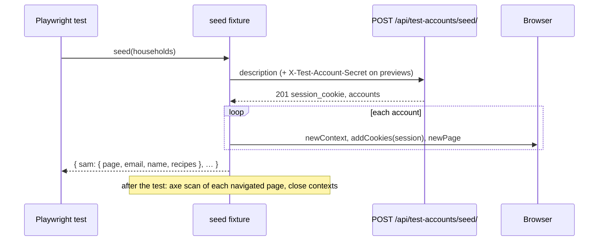

# Seed signed-in test accounts for e2e and verify

Linear: TAS-153

## Summary

Every e2e test and every verify walk that needs someone signed in signs up through the screens first, and each spec carries its own copy of the steps. Anything needing two people or two households costs a page of clicks, so TAS-151's verify left two criteria unverified. This adds a test-only seed endpoint that makes test accounts, their households and the recipes they wrote in one call and answers with a signed-in session for each. It also adds a Playwright `seed` fixture over it with named setups, and moves the specs that only sign up to get going onto it.

Evidence: chore. Nothing a user sees changes: the endpoint answers 404 on production, and the rest is test code and docs.
Design: skip. No UI changes.

## Required reading

- `AGENTS.md`: Domain areas (dependency direction, public surfaces), API contract, Tests.
- `backend/households/views.py:48-75`: `may_read_codes` and `TestAccountCodeView`, the gate and the 404 the seed mirrors.
- `backend/health/`: the shape of a small non-area app (`apps.py`, `urls.py`, `views.py`, `serializers.py`, `services.py`); mirror it for `backend/seed/`.
- `backend/recipes/services.py:161-326`: the catalogue loader's record shape and its helpers (`_plain_fields`, `_look_up`, `_lines`, `_save`), which the seeded recipe reuses.
- `backend/households/services.py:38-55`: `household_name_for` and `name_account`; seeded households are named the same way.
- `backend/tests/test_test_accounts.py`: the `test_accounts` settings fixture and the parametrised 404 cases to mirror.
- `frontend/e2e/fixtures.ts`: the `accessibility` fixture the `seed` fixture sits beside.
- `frontend/e2e/test-accounts.ts`: `readSignInCode` and its secret header, which the seed request mirrors.
- `frontend/e2e/household.spec.ts:117-189`: how a second person gets a context of their own (`browser.newContext({ baseURL, extraHTTPHeaders, reducedMotion: 'reduce' })`).
- `specs/lessons/admin-user-fixture-has-a-password.md`: an account made in code needs no usable password and a verified `EmailAddress`, or signing in by code later stops at `verify_email`.
- `specs/lessons/blank-model-fields-are-optional-in-the-schema.md`: why the response serializers are plain `Serializer`s.

## Product behaviour

1. A test gets signed-in accounts in any combination of households and recipes with one call.
2. A new combination of existing models needs only a new description, no endpoint change.
3. The seed answers 404 when test accounts are off, and needs the secret on previews.
4. The account, household and admin specs sign up through the screens only where that's tested.
5. `AGENTS.md` names the seed, the fixture and the setups, when to use them, and when to extend them.
6. A housemate sees a private recipe's missing parts, and another household gets "Recipe not found".

## Technical design

- **Approach:**
  - **Gate.** `may_read_codes` (`backend/households/views.py:48`) moves to `backend/households/services.py` as `may_use_test_accounts(headers: Mapping[str, str]) -> bool`, unchanged in logic, since it now gates two endpoints in two apps. `TestAccountCodeView` calls `may_use_test_accounts(request.headers)`.
  - **Households service.** `backend/households/services.py` gains `TestMember`, `add_test_household` and `start_session` (sketched below). The households area makes its own rows: the seed app never touches `User`, `Household` or `EmailAddress` directly.
  - **Recipes service.** `backend/recipes/services.py` gains `add_described_recipes(author, records)`. A record has the shape of a recipe in `recipes/catalogue.json`, without its `slug`. It reuses the loader's helpers, so every plain field on `Recipe`, `IngredientGroup` and `IngredientLine` is accepted with no list to keep in step. `_by_name`'s type parameter widens to `Cuisine | Course | Equipment | Ingredient`.
  - **Seed app.** New `backend/seed/`. It isn't a domain area: it may call every area's `services.py`, and nothing imports it. `services.seed(households)` runs in one `transaction.atomic()`. It calls `add_test_household` for each household, then `add_described_recipes` for each member's recipes, then `start_session` for each account. Any refusal rolls the whole seed back.
  - **Endpoint.** `POST /api/test-accounts/seed/`, `SeedView` in `backend/seed/views.py`, with `authentication_classes = []` and `permission_classes = []`, as `TestAccountCodeView` has. It answers 404 before reading the body unless `may_use_test_accounts(request.headers)`. A `CatalogueError` becomes a DRF `ValidationError(str(error))`, which answers 400 with `["<message>"]`.
  - **Fixture.** `frontend/e2e/fixtures.ts` gains a `seed` fixture. It posts the description, then opens each account in a browser context of its own with the session cookie set, and closes those contexts after the test. The test's own `page` stays signed out, so it serves as the visitor. The end-of-test axe scan covers each seeded page as well as `page`, skipping any page never navigated (`about:blank`). `accessibility.check` takes an optional page.
  - **Setups.** `frontend/e2e/setups.ts` holds the named descriptions.
- **API contract:** new endpoint; regenerate `backend/schema.yml` and `frontend/src/api/schema.d.ts`.

```diff
+ POST /api/test-accounts/seed/        operation_id test_account_seed_create
+   request  Seed      { households: SeedHousehold[] }                      1 to 10 households
+            SeedHousehold { name?: string; members: SeedMember[] }         1 to 10 members; name ≤ 100
+            SeedMember { key: string; name: string; unit_system?: UnitSystem; recipes?: { [field: string]: unknown }[] }
+                                                                           key ^[a-z][a-z0-9-]{0,19}$, unique in the call;
+                                                                           name 1 to 50; at most 20 recipes
+   201      Seeded    { session_cookie: string; accounts: { [key: string]: SeededAccount } }
+            SeededAccount { email: string; name: string; session: string; recipes: SeededRecipe[] }
+            SeededRecipe  { title: string; slug: string }                  in the order the member's recipes were given
+   400      a field, a repeated key, or a recipe the database can't hold   nothing is saved
+   404      test accounts off, or the secret missing or wrong where it's needed
```

A request and its answer:

```json
{
  "households": [
    {
      "members": [
        { "key": "sam", "name": "Sam", "recipes": [{ "title": "Grandma's curry", "cuisines": ["Indian"], "prep_minutes": 20 }] },
        { "key": "ben", "name": "Ben", "unit_system": "us" }
      ]
    },
    { "name": "The Lovelaces", "members": [{ "key": "cy", "name": "Cy" }] }
  ]
}
```

```json
{
  "session_cookie": "sessionid",
  "accounts": {
    "sam": { "email": "sam-1f3a9c07@tastebook.test", "name": "Sam", "session": "…", "recipes": [{ "title": "Grandma's curry", "slug": "grandmas-curry-x7k2qp" }] },
    "ben": { "email": "ben-8b02d4e1@tastebook.test", "name": "Ben", "session": "…", "recipes": [] },
    "cy": { "email": "cy-55c0e9aa@tastebook.test", "name": "Cy", "session": "…", "recipes": [] }
  }
}
```

A household with no `name` is named after its first member, as `household_name_for` does (`"Sam's household"`). Every seeded recipe is a household recipe, so it's private (`Recipe.visibility`, `backend/recipes/models.py:363`). A recipe record takes the catalogue's keys: any plain `Recipe` field, `cuisines`, `courses` and `equipment` by name, `ingredient_lines` (each with `ingredient` by name and any plain `IngredientLine` field), `ingredient_groups` (`{ "name", "lines" }`) and `steps` as strings. Leaving out `ingredient_lines`, `ingredient_groups` and `steps` makes a recipe with no ingredients or method.

```py
# backend/households/services.py
@dataclass(frozen=True)
class TestMember:
    key: str
    name: str
    unit_system: UnitSystem


def add_test_household(name: str | None, members: list[TestMember]) -> list[User]:
    """A new household of new test accounts, one a member, in the members' order; named after the first member when
    no name is given. Each account has no usable password and a verified address at the test domain made of its key
    and eight random hex characters, so a seed never meets an account that exists."""
    # create_user(email, name=..., household=..., unit_system=...) leaves the password unusable;
    # EmailAddress.objects.create(user=..., email=..., verified=True, primary=True) for each.


def start_session(account: User) -> str:
    """Signs the account in on a new session, as signing in does, and returns the session's key."""
    # request = HttpRequest(); request.session = import_module(settings.SESSION_ENGINE).SessionStore()
    # login(request, account, backend='django.contrib.auth.backends.ModelBackend'); request.session.save()
```

```py
# backend/recipes/services.py
def add_described_recipes(author: User, records: list[Record]) -> list[Recipe]:
    """Saves private recipes in the author's household, each from a record shaped as a recipe in the catalogue file
    without its slug. Raises CatalogueError naming the recipe and what the database can't hold in it."""
    # Looks every cuisine, course, equipment and ingredient up by name once, then for each record, as Recipe "<title>":
    # Recipe(household_id=author.household_id, created_by=author, slug=private_slug_for(title), **_plain_fields(...)),
    # _save (full_clean, so a half-given pair is refused), .set() the three links from _look_up, then the groups,
    # _lines(...) and the steps, each _save'd.
```

```py
# backend/seed/services.py
@dataclass(frozen=True)
class SeededAccount:
    email: str
    name: str
    session: str
    recipes: list[Recipe]


def seed(households: list[dict[str, Any]]) -> dict[str, SeededAccount]:
    """Makes the described households, members and recipes in one transaction and signs each member in.
    Keyed by each member's key. Raises CatalogueError for a recipe the database can't hold."""
```

```ts
// frontend/e2e/fixtures.ts
type SeedMember = components['schemas']['SeedMember'];
// A household as the seed takes it, its members' keys kept as literals so the result is typed by them.
export type SeedHouseholdOf<Key extends string> = Omit<components['schemas']['SeedHousehold'], 'members'> & {
  members: (SeedMember & { key: Key })[];
};
export type SeededAccount = Omit<components['schemas']['SeededAccount'], 'session'> & { page: Page };
type Seeding = <const Key extends string>(households: SeedHouseholdOf<Key>[]) => Promise<Record<Key, SeededAccount>>;
type Accessibility = { check: (on?: Page) => Promise<void> };
```

The `seed` fixture depends on `browser`, `request`, `baseURL` and `extraHTTPHeaders`. For each account it calls `browser.newContext({ baseURL, extraHTTPHeaders, reducedMotion: 'reduce' })`, then `context.addCookies([{ name: session_cookie, value: session, url: baseURL }])` (the `url` makes the cookie secure on a preview's HTTPS), then `context.newPage()`. Its teardown scans each seeded page, when the test passed and the page was navigated, with the same function as `accessibility`, then closes the contexts. That function moves to module level in `fixtures.ts` as `scan(page: Page)`.



### Steps

1. **Move the test-account gate into services.** `backend/households/services.py` (edit), `backend/households/views.py` (edit)
   Move `may_read_codes` to services as `may_use_test_accounts(headers: Mapping[str, str]) -> bool`, logic unchanged, with `hmac` imported there. `TestAccountCodeView.get` calls it with `request.headers`. Commit it on its own, before the seed.
   Done when: `uv run pytest tests/test_test_accounts.py` passes unchanged.

2. **Make test households and sessions.** `backend/households/services.py` (edit)
   Add `TestMember`, `add_test_household` and `start_session` as sketched. Addresses are `f'{key}-{secrets.token_hex(4)}@{settings.TEST_ACCOUNT_DOMAIN}'`. Import `EmailAddress` from `allauth.account.models`, and `login` from `django.contrib.auth`, at module level.
   Done when: the seed tests in step 5 that sign in with a seeded session, and the one that signs in by code, pass.

3. **Add described recipes.** `backend/recipes/services.py` (edit)
   Add `add_described_recipes` as sketched. Its references set is `{'cuisines', 'courses', 'equipment', 'ingredient_lines', 'ingredient_groups', 'steps'}` (no `slug`, so a record that gives one is refused as an unknown field). Use `record.get('title', '')` for the slug and the `where`, so a missing title fails `full_clean` with a message rather than a `KeyError`. Widen `_by_name`'s type parameter.
   Done when: the recipe cases in `backend/tests/test_seed.py` pass, and `uv run pytest tests/test_catalogue.py` still passes.

4. **Add the seed app and endpoint.** `backend/seed/__init__.py`, `apps.py`, `serializers.py`, `services.py`, `views.py`, `urls.py` (new); `backend/config/settings.py` (edit: `'seed'` in `INSTALLED_APPS` after `'recipes'`); `backend/config/urls.py` (edit: `path('api/test-accounts/seed/', include('seed.urls'))` before the `api/test-accounts/` include)
   Request serializers are `SeedSerializer`, `SeedHouseholdSerializer` and `SeedMemberSerializer`, with the bounds in the API contract. `recipes` is `ListField(child=DictField(), max_length=20, default=list)`. `unit_system` is `ChoiceField(UnitSystem.choices, default=UnitSystem.METRIC)`. `SeedSerializer.validate_households` refuses repeated keys with "Each member needs a key of its own; these repeat: <keys>". Response serializers are `SeededSerializer`, `SeededAccountSerializer` and `SeededRecipeSerializer`, all plain `Serializer`s; `accounts` is `DictField(child=SeededAccountSerializer())`, and `session_cookie` is `settings.SESSION_COOKIE_NAME`. `extend_schema` gives `operation_id='test_account_seed_create'`, `request=SeedSerializer`, `responses={201: SeededSerializer, 400: OpenApiResponse(...), 404: None}`, and a description saying: local runs and previews only, 404 on production.
   Done when: `backend/tests/test_seed.py` passes.

5. **Test the endpoint.** `backend/tests/test_seed.py` (new), with the cases under Tests.
   Done when: `uv run pytest` passes, and each 404 case fails when `SeedView` skips the gate.

6. **Regenerate the contract.** `backend/schema.yml`, `frontend/src/api/schema.d.ts` (generated)
   Done when: `spectacular --file schema.yml --validate --fail-on-warn` is clean and `pnpm generate:api` leaves no diff after committing.

7. **Add the fixture and setups.** `frontend/e2e/test-accounts.ts`, `frontend/e2e/fixtures.ts` (edit); `frontend/e2e/setups.ts` (new)
   `test-accounts.ts` gains `seedAccounts(request: APIRequestContext, seed: Seed): Promise<Seeded>`. It posts to `/api/test-accounts/seed/` with the same secret header as `readSignInCode`, and expects 201 with the message `seeding test accounts`. `fixtures.ts` gains `seed`, `scan` and `check(on?: Page)` as described above. `setups.ts` exports two setups, typed so their keys stay literal:
   - `soleCook: SeedHouseholdOf<'sam'>[]`: Sam, alone in "Sam's household".
   - `unfinishedRecipe: SeedHouseholdOf<'sam' | 'ben' | 'cy'>[]`: Sam and Ben in "Sam's household", and Cy in "Cy's household". Sam wrote "Grandma's curry" with `cuisines: ['Indian']` and `prep_minutes: 20`, so it lacks ingredients, method, cook time and servings.
   Done when: `pnpm lint` is clean.

8. **Move the specs onto the seed.** `frontend/e2e/account.spec.ts`, `household.spec.ts`, `admin.spec.ts`, `recipe-new.spec.ts` (edit)
   - `account.spec.ts`: drop `signInFromTheBar` and `signUpAs`. Both tests `seed(soleCook)` and open the account page from `sam.page` after `sam.page.goto('/recipes/baguette')`. The forced-colours test calls `sam.page.emulateMedia({ forcedColors: 'active' })`. `openAccountPage` takes the seeded page and passes it to `accessibility.check`.
   - `household.spec.ts`: drop `signInFromTheBar` and `signUpAs`. The rename, invite and forced-colours tests seed `soleCook`. In the join test, Sam is seeded (no `samsContext`), and Ann stays `page`, signing in through the invite link as a new account, since that's what it tests. `signInWithCode` is used only there, so inline its steps in that test. `writeRecipe` stays.
   - `admin.spec.ts`: drop `signUp`. The not-staff test seeds `soleCook` and requests `/admin/` with `sam.page.request`. The staff test seeds `soleCook`, runs `make_staff` with `sam.email`, and works on `sam.page`. Its second sign-in goes through the screens, as it's under test; `signInWithEmailCode` is used only there, so inline it.
   - `recipe-new.spec.ts`: three tests.
     - Signed out, "Add a recipe" leads to `/sign-in?next=%2Frecipes%2Fnew`.
     - `soleCook` Sam adds the recipe through the form from `/recipes` and finds it in the list; the steps and assertions are today's, from filling the title on. The signed-out visitor is `page`.
     - `unfinishedRecipe`: Ben opens Sam's recipe at `/recipes/${sam.recipes[0].slug}` and sees it with its gaps, and Cy gets "Recipe not found".
   Done when: `pnpm test:e2e` passes locally, and `grep -n "readSignInCode\|newTestAccountEmail" frontend/e2e/{account,admin}.spec.ts` finds nothing.

9. **Document the seed.** `AGENTS.md`, `docs/architecture.md`, `GLOSSARY.md` (edit)
   - `AGENTS.md` Layout, `backend/`: `seed/  test-only endpoint that makes signed-in test accounts, households and recipes (POST /api/test-accounts/seed/); not an area: it calls every area's services.py and nothing imports it`.
   - `AGENTS.md` Layout, `frontend/`: the `e2e/` line becomes `Playwright specs (run against the real backend); fixtures.ts's seed() gives signed-in accounts, setups.ts the named setups`.
   - `AGENTS.md` Tests gets two bullets:
     - `[a] start an e2e test or a verify walk that needs someone signed in from seed() (frontend/e2e/fixtures.ts), with a setup from frontend/e2e/setups.ts when one fits; go through the sign-in screens only when signing in or up is what's tested. A combination used by a second spec or walk becomes a named setup.`
     - `[a] when a PR adds a model, a field or a state the seed can't make, extend the seed (backend/seed/ and the area's service it calls) in the same PR.`
   - `docs/architecture.md:54`: after the sentence on `GET /api/test-accounts/code/`, add that `POST /api/test-accounts/seed/` makes signed-in test accounts with their households and recipes for e2e tests and verify, behind the same rules.
   - `GLOSSARY.md` Test account row: add `seed()` to its code column and "the seed makes them signed in, with households and recipes" to its meaning.
   Done when: the text is in and `pnpm lint` is clean.

### Tests

- `backend/tests/test_seed.py` (new; reuses `test_accounts` and `SECRET` from `tests/test_test_accounts.py`, and `ingredient` from `tests/test_recipes.py`; each client sends a seeded session with `client.cookies[body['session_cookie']] = account['session']`)
  - Two members seeded into a named household are each signed in to it, asserts: Ada's `GET /api/household/` has `name == 'The Lovelaces'` and members `[('Ada', True), ('Ben', False)]` as `(name, is_you)`; Ben's `GET /api/account/` has `account.name == 'Ben'` and an email matching `^ben-[0-9a-f]{8}@tastebook\.test$`.
  - A household given no name is named after its first member, and the unit system is kept, asserts: `GET /api/household/` name `"Sam's household"`; Sam's `GET /api/account/` has `unit_system == 'us'` when seeded with `us`, and `'metric'` for a member given none.
  - A seeded recipe has the described fields and parts, asserts: Ada's `GET /api/recipes/<slug>/` has `visibility == 'private'`, `prep_minutes == 20`, `cook_minutes is None`, cuisine names `['Italian']`, `ingredient_lines[0]` with `amount == 2` and ingredient name `'onion'`, `ingredient_groups[0]['name'] == 'For the sauce'`, and steps texts `['Fry the onion.']`; the slug in the seed's answer matches `^grandmas-curry-[a-hjkmnp-z2-9]{6}$`.
  - A recipe given only a title has no ingredients or method, asserts: its detail has `ingredient_lines == []`, `ingredient_groups == []`, `steps == []`.
  - Another household doesn't see a seeded recipe, asserts: Cy's `GET /api/recipes/<Ada's slug>/` is 404 while Ada's is 200.
  - A seeded account can sign in by code later, asserts: `BrowserClient().post('code/request', {'email': <seeded email>})` then `post('code/confirm', {'code': stored code})` leaves `signed_in_email(browser)` equal to the seeded email.
  - A preview seeds with the bypass secret, asserts: status 201 with `TEST_ACCOUNT_CODES_NEED_SECRET = True` and the right `X-Test-Account-Secret`.
  - Parametrised, the seed isn't found unless test accounts may be used (production, preview without secret, preview with wrong secret, preview with no secret set), asserts: `(404, {'detail': 'Not found.'})` and `User.objects.count() == 0`.
  - Parametrised, a description the seed can't make saves nothing, asserts: status 400, `User.objects.count() == 0` and `Household.objects.count() == 0`, for:
    - a repeated key (body contains `'Each member needs a key of its own; these repeat: sam'`);
    - a recipe field the catalogue doesn't know (`colour`; body `['Recipe "Curry" has fields the catalogue does not know: colour']`);
    - an unknown ingredient (body `['Recipe "Curry" names no known ingredient: "unobtainium"']`);
    - servings and a yield together (body contains `'Give servings or a yield with its unit, not both.'`);
    - a household with no members;
    - a key with a capital letter.
- `frontend/e2e/recipe-new.spec.ts`
  - Signed out, "Add a recipe" asks to sign in first, asserts: URL matches `/\/sign-in\?next=%2Frecipes%2Fnew$/` and the level-1 heading "Sign in" is visible.
  - A cook adds a private recipe that only their household finds, asserts: today's assertions from the URL `grandmas-curry-…` to the visitor's "No recipes match “Grandma”.", run on `sam.page` with `page` as the visitor.
  - Only the household sees what a private recipe is missing, asserts: on `ben.page` the level-1 heading matches `CURRY_HEADING`, "Private" is visible, and "No ingredients yet", "No method yet", "No cook time yet" and "No servings yet" are each visible; on `cy.page` the level-1 heading "Recipe not found" is visible.
- `frontend/e2e/account.spec.ts`, `household.spec.ts`, `admin.spec.ts`: every existing assertion kept, now on seeded pages.
- Checks: `pnpm lint`, `pnpm test`, `uv run ruff check . && uv run ruff format --check .`, `uv run pytest`, `pnpm test:e2e`, and the API contract job.

## Decisions

- The seed's code lives in a new `backend/seed/` app, not an area, because it makes every area's rows. In `households` it would break "households depends on no other area"; in `recipes` it would own accounts. Asked: Where should the seed endpoint's code live? → New seed app.
- The seed can't make a staff account, because anyone holding the previews' bypass secret could then mint a superuser on a preview's database. The admin two-factor spec seeds an ordinary account and keeps `make_staff`, so it still skips on previews. Asked: Should the seed be able to make a staff account? → No staff.
- `recipe-new.spec.ts` keeps one signed-out check that "Add a recipe" leads to sign-in. The rest starts seeded, and a new test covers the two criteria TAS-151 left unverified: a housemate sees the gaps, and another household gets "Recipe not found". Asked: How far should recipe-new.spec.ts move onto the seed? → Seed it, add both checks.
- It ships as one PR, so the endpoint is proved by the specs that use it. Asked: Should this ship as one PR or two? → One PR.
- The seed makes each address from the member's key and random characters, and the caller can't give one, because a seed then can't collide with an account that exists or sign anyone in as a real one. Parallel workers and a preview's long-lived database never clash.
- A description nests recipes under the member who wrote them, and members under their household, because a recipe must be in its author's household. The shape can't express a recipe written in another household.
- A recipe is described in the catalogue file's shape and read by the loader's helpers, because that already accepts every plain field of a recipe, line and group, with tested messages. A new plain field then needs no seed change; a new relation does.
- Each seeded account opens in its own browser context, and the test's own `page` stays signed out, because tests such as the household join need `page` as the signed-out person. Making "the first account takes `page`" a rule would be implicit and wrong for them. The seed fixture scans its pages, so no page escapes axe.
- The session is made with Django's `login()` on a fresh session store, as `django.test.Client.force_login` does, because the app reads sign-in from the Django session. allauth's flows add nothing a seeded account needs, and the admin's reauthentication passes without a password, as `backend/tests/conftest.py`'s `admin_client` shows.
- Two named setups, `soleCook` and `unfinishedRecipe`. `unfinishedRecipe` holds the three states the issue names (an author with a private recipe missing parts, a housemate, someone in another household), since each spec and walk can ignore accounts it doesn't use. A third setup waits for its second user.
- The gate moves into `households/services.py` as `may_use_test_accounts`, because the seed app may reach households only through its services. The new name says what it now gates.

## Assumptions

- The previews' sessions work from a cookie set by Playwright: `SESSION_COOKIE_SECURE` is on there, and `addCookies` with the preview's HTTPS `url` sets a secure cookie. Confirm with: the PR's preview e2e run.
- Up to 10 households of 10 members with 20 recipes each is room enough for any test or walk, and bounds what a bypass-secret holder can make in one call. Confirm with: Milo at approval.
- The e2e database has the catalogue loaded (cuisines from migrations, ingredients from `load_catalogue`), as today's specs already assume with `/recipes/baguette`. Confirm with: the CI e2e job.

## Out of scope

- Invites, catalogue recipes, nameless accounts and staff accounts in the seed. A PR that needs one extends the seed, per the new `AGENTS.md` rule.
- Requests that fail or are slow (a 403, a network failure, "Saving…"): they need request mocking, a separate decision.
- `sign-in.spec.ts` and `sign-in-api.spec.ts`: signing in is what they test.
- `household.spec.ts`'s `writeRecipe` and its stale comment, and Ann's sign-up through the invite link.
- Renaming `TEST_ACCOUNT_CODES_NEED_SECRET`, though it now gates the seed too.
- Changing the verify stage itself; it reads the new `AGENTS.md` bullets.

## Validation criteria

- [ ] `uv run ruff check . && uv run ruff format --check .` and `uv run pytest` pass (in `backend/`).
- [ ] `pnpm lint` and `pnpm test` pass.
- [ ] `pnpm test:e2e` passes locally, and the preview checks' e2e run passes on the PR's preview.
- [ ] The API contract job passes with the regenerated `schema.yml` and `schema.d.ts`.
- Evidence: chore: "No visible change." and the checks line.
