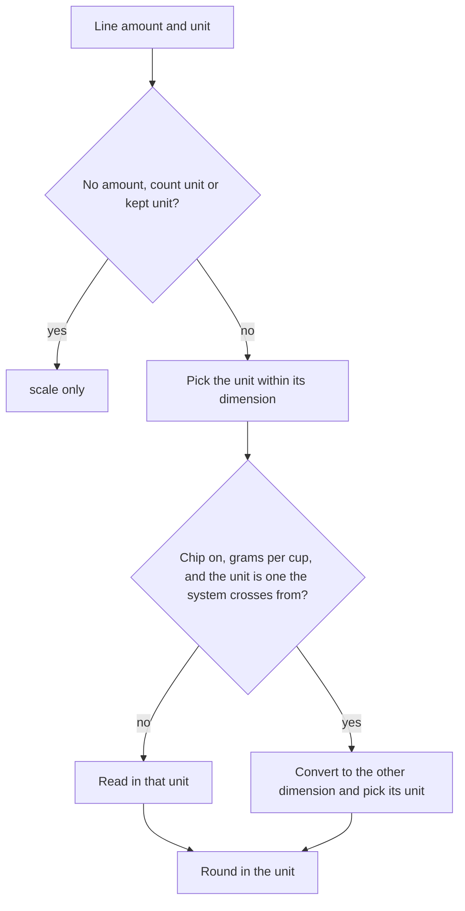

# Convert volume to weight for dry ingredients

Linear: TAS-20

## Summary

Today an amount converts only within its dimension, so in metric "1 cup plain flour" reads as 240 ml, and in US customary "200 g plain flour" reads as 7 oz. This gives 38 dry goods in the shared ingredient list (flours, sugars, oats, rice, grains, cocoa, breadcrumbs, dried fruit and nuts) a weight per cup from USDA FoodData Central. With it, a dry good's cups and millilitres read as grams in metric, and its grams read as spoons and cups in US customary. An ingredient with no weight per cup converts as it does today. A chip on the recipe page ("Cups to grams" in metric, "Grams to cups" in US customary) turns this off for the visit.

People see it in both unit systems. In US customary, the catalogue's own recipes weigh their dry goods in grams, so the oat and raisin cookies' flour reads "1 cup" instead of "4.5 oz". In metric, 26 recipes adapted from Wikibooks measure a dry good in millilitres, so the tabbouleh's bulgur wheat reads "75 g" instead of "125 ml".

Evidence: feature. People see cups where they saw ounces in US customary, grams where they saw millilitres in metric, and a new chip on the recipe page.
Design: skip. The only new control is a Filter chip, the component the same row already uses for Show original, in its existing off and on states. `docs/design.md` (Components, Filter chip) decides its look, and the row already wraps.

## Required reading

- `AGENTS.md`: hard constraints, API contract, Tests.
- `specs/lessons/blank-model-fields-are-optional-in-the-schema.md`: why the serializer declares the new field `read_only` instead of letting the `ModelSerializer` make it optional.
- `frontend/src/recipes/convert.ts`: `measures`, `systems` and `convert()`, which this extends.
- `frontend/src/recipes/convert.test.ts`: the table the new cases mirror.
- `frontend/src/recipes/recipe-ingredients.tsx`: `Reading`, `amountOf` and `canShowOriginal`, the pattern for the new `canCrossDimensions`.
- `frontend/src/recipes/recipe-page.tsx:48-139`: `RecipeControls` and `RecipeBody`, where Show original lives; the new chip mirrors it.
- `backend/recipes/services.py:97-117` (`_load_named`) and `:207-217` (`_plain_fields`): the loader picks up any new editable model field from `catalogue.json` with no loader change, and refuses a value the field's validators refuse.
- `backend/tests/test_catalogue.py:330-341` and `:557-660`: the catalogue tests the new ones mirror.

## Product behaviour

1. In metric, a dry good written in cups or millilitres reads in grams ("1 cup plain flour" reads "125 g").
2. In metric, a dry good written in teaspoons or tablespoons, or small enough to read in spoons, stays in spoons.
3. In US customary, a dry good written in grams or kilograms reads in teaspoons, tablespoons or cups ("125 g plain flour" reads "1 cup").
4. A unit the unit system keeps (grams in metric; ounces, pounds, spoons and cups in US customary) stays as written.
5. An ingredient with no weight per cup converts within its dimension, as it does today.
6. Scaling the servings changes a converted amount, rounded to what can be measured in its unit.
7. A "Cups to grams" chip (metric) or "Grams to cups" chip (US customary), on by default, turns the conversion off and on for this visit.
8. The chip is offered only while turning it off would change at least one amount on the page.
9. Show original still shows each line as its source wrote it.

## Technical design

### How it works today

- `Ingredient` (`backend/recipes/models.py:283`) holds a name, a slug and the `contains_*` flags. `IngredientSerializer` (`backend/recipes/serializers.py:37`) sends `slug` and `name`, nested in every `IngredientLine` and every `DietTagConflict` of the recipe response.
- `catalogue.json`'s 560 ingredients give `name`, `synonyms` and the `contains_*` flags. `_load_named` builds each row from the record's keys that are editable concrete fields (`_plain_fields`), so a new field loads from the file with no loader change, and a row the file doesn't give it to goes back to its default.
- `convert(quantity, factor, system)` (`frontend/src/recipes/convert.ts:70`) scales a line and reads it in the system's unit for its dimension: `systems[system].units[dimension]` picks the unit from the size in grams or millilitres. Units the system `keeps` only scale.
- `amountOf` (`frontend/src/recipes/recipe-ingredients.tsx:14`) is the only caller of `convert`. It reads `factor` and `system` from the page's `Reading` (`:12`).
- `RecipeBody` (`frontend/src/recipes/recipe-page.tsx:89`) owns the reading's state (`scaledTo`, `chosenSystem`, `showOriginal`), none of it remembered between visits. Choosing a unit system turns Show original off (`chooseSystem`, `:97`). `RecipeControls` (`:48`) shows Servings, Units and, when `canShowOriginal`, the Show original chip.

### Data

`backend/recipes/models.py`, `Ingredient` (edit), after `contains_gluten`:

```py
grams_per_cup = models.PositiveSmallIntegerField(
    null=True,
    blank=True,
    validators=[MinValueValidator(1)],
    help_text='What a US cup of it weighs, from USDA FoodData Central. Only dry goods have one.',
)
```

Import `MinValueValidator` from `django.core.validators` at module level, unless the module already does. Migration `backend/recipes/migrations/0014_ingredient_grams_per_cup.py`, made by `makemigrations`.

`backend/recipes/catalogue.json` (edit): add `"grams_per_cup": <n>` to exactly these 38 ingredient records. Each value is the cup weight in USDA FoodData Central's SR Legacy data (April 2018 release, CC0), by its FDC ID:

| Catalogue ingredient | `grams_per_cup` | USDA food (FDC ID), portion |
| --- | --- | --- |
| plain flour | 125 | Wheat flour, white, all-purpose, enriched, bleached (168894), 1 cup |
| self-raising flour | 125 | Wheat flour, white, all-purpose, self-rising, enriched (168895), 1 cup |
| strong white bread flour | 137 | Wheat flour, white, bread, enriched (168896), 1 cup |
| wholemeal flour | 120 | Wheat flour, whole-grain (168893), 1 cup |
| cornflour | 128 | Cornstarch (169698), 1 cup |
| rice flour | 158 | Rice flour, white, unenriched (169714), 1 cup |
| gram flour | 92 | Chickpea flour (besan) (174288), 1 cup |
| polenta | 157 | Cornmeal, degermed, enriched, yellow (168867), 1 cup |
| semolina | 167 | Semolina, enriched (169715), 1 cup |
| granulated sugar | 200 | Sugars, granulated (169655), 1 cup |
| caster sugar | 200 | Sugars, granulated (169655), 1 cup |
| light brown soft sugar | 220 | Sugars, brown (168833), 1 cup packed |
| dark brown soft sugar | 220 | Sugars, brown (168833), 1 cup packed |
| icing sugar | 120 | Sugars, powdered (169656), 1 cup unsifted |
| porridge oats | 81 | Cereals, oats, regular and quick, not fortified, dry (173904), 1 cup |
| long-grain rice | 185 | Rice, white, long-grain, regular, raw, enriched (168877), 1 cup |
| basmati rice | 185 | Rice, white, long-grain, regular, raw, enriched (168877), 1 cup |
| short-grain rice | 200 | Rice, white, short-grain, raw, unenriched (168931), 1 cup |
| pudding rice | 200 | Rice, white, short-grain, raw, unenriched (168931), 1 cup |
| paella rice | 195 | Rice, white, medium-grain, raw, enriched (168879), 1 cup |
| pearl barley | 200 | Barley, pearled, raw (170284), 1 cup |
| bulgur wheat | 140 | Bulgur, dry (170688), 1 cup |
| brown lentils | 192 | Lentils, raw (172420), 1 cup |
| cocoa powder | 86 | Cocoa, dry powder, unsweetened (169593), 1 cup |
| dried breadcrumbs | 108 | Bread, crumbs, dry, grated, plain (174928), 1 cup |
| fresh breadcrumbs | 45 | Bread, white, commercially prepared (174924), 1 cup, crumbs |
| raisins | 145 | Raisins, dark, seedless (168165), 1 cup not packed |
| sultanas | 145 | Raisins, golden, seedless (168164), 1 cup not packed |
| currants | 144 | Currants, zante, dried (171724), 1 cup |
| dates | 147 | Dates, deglet noor (171726), 1 cup, chopped |
| almonds | 143 | Nuts, almonds (170567), 1 cup, whole |
| blanched almonds | 145 | Nuts, almonds, blanched (170568), 1 cup whole kernels |
| flaked almonds | 92 | Nuts, almonds (170567), 1 cup, sliced |
| walnuts | 117 | Nuts, walnuts, english (170187), 1 cup, chopped |
| cashew nuts | 137 | Nuts, cashew nuts, dry roasted, without salt added (170571), 1 cup, halves and whole |
| pine nuts | 135 | Nuts, pine nuts, dried (170591), 1 cup |
| pistachios | 123 | Nuts, pistachio nuts, raw (170184), 1 cup |
| peanuts | 146 | Peanuts, all types, raw (172430), 1 cup |

Every other ingredient gets no `grams_per_cup` and stays `null`.

### API contract

`backend/recipes/serializers.py`, `IngredientSerializer` (edit):

```py
class IngredientSerializer(serializers.ModelSerializer):
    # Declared read-only so the schema lists it as always sent; a blank=True field would come out optional.
    grams_per_cup = serializers.IntegerField(read_only=True, allow_null=True)

    class Meta:
        model = Ingredient
        fields = ['slug', 'name', 'grams_per_cup']
```

The `Ingredient` component in `backend/schema.yml` gains a required, read-only, nullable `grams_per_cup` integer, and `schema.d.ts` types it `readonly grams_per_cup: number | null`. It reaches `IngredientLine.ingredient` and `DietTagConflict.ingredient`; no endpoint, path or parameter changes. `IngredientOptionSerializer` (`/api/ingredients/`) is unchanged.

### Conversion (`frontend/src/recipes/convert.ts`, edit)

Each system names the units that a dry good reads in the other dimension instead of: metric's `ml` and `l` (so spoons stay spoons), US customary's `oz` and `lb`. `convert` picks the unit as today; when the line has a weight per cup and that unit is one the system crosses from, it converts the amount into the other dimension and picks the unit there. The units the system `keeps` still only scale, before anything else is looked at.

```ts
type System = {
  keeps: ReadonlySet<Unit | ''>;
  units: Record<Dimension, (size: number) => MeasuredUnit>;
  // Units a dry good with a weight per cup reads in the other dimension instead: grams for metric's millilitres,
  // spoons and cups for US customary's ounces.
  crosses: ReadonlySet<MeasuredUnit>;
};
// metric: crosses: new Set(['ml', 'l']); us: crosses: new Set(['oz', 'lb'])

const otherDimension: Record<Dimension, Dimension> = { mass: 'volume', volume: 'mass' };

// Grams in a millilitre of it, or millilitres in a gram, by the dimension converted from.
const across = (from: Dimension, gramsPerCup: number) =>
  from === 'volume' ? gramsPerCup / measures.cup.size : measures.cup.size / gramsPerCup;

// Scales a line's amount by factor and reads it in system. An amount converts within its dimension, except a dry
// good's (one with gramsPerCup): its millilitres read as grams in metric, its ounces as spoons and cups in US
// customary. Count units and units the system keeps only scale, so they round as scale() rounds them.
export const convert = <T extends Quantity>(
  quantity: T,
  factor: number,
  system: UnitSystem,
  gramsPerCup: number | null
): T => {
  const { amount, amount_max, unit } = quantity;
  const { keeps, units, crosses } = systems[system];
  if (amount === null || !isMeasured(unit) || keeps.has(unit)) {
    return scale(quantity, factor);
  }
  const { dimension, size } = measures[unit];
  const top = amount_max ?? amount;
  const within = units[dimension](top * factor * size);
  const ratio = gramsPerCup !== null && crosses.has(within) ? across(dimension, gramsPerCup) : null;
  const toBase = (value: number) => value * factor * size * (ratio ?? 1);
  const target = ratio === null ? within : units[otherDimension[dimension]](toBase(top));
  if (target === unit) {
    return scale(quantity, factor);
  }
  const inTarget = (value: number) => toBase(value) / measures[target].size;
  return {
    ...quantity,
    unit: target,
    ...roundIn(target, inTarget(amount), amount_max === null ? null : inTarget(amount_max))
  };
};
```

`gramsPerCup` is required, not defaulted, so the one caller can't leave it out by accident. The base in `measures` stays a US cup of 240 ml, the cup USDA weighs.

### Reading (`frontend/src/recipes/recipe-ingredients.tsx`, edit)

```ts
export type Reading = { factor: number; system: UnitSystem; showOriginal: boolean; crossesDimensions: boolean };

const amountOf = (line: IngredientLine, { factor, system, crossesDimensions }: Reading) =>
  formatQuantity(convert(line, factor, system, crossesDimensions ? line.ingredient.grams_per_cup : null));

// Offered whatever its state, so it shows only while turning it off or on would change an amount.
export const canCrossDimensions = (recipe: Recipe, reading: Reading) =>
  linesOf(recipe).some(
    (line) =>
      amountOf(line, { ...reading, crossesDimensions: true }) !== amountOf(line, { ...reading, crossesDimensions: false })
  );
```

`describeLine`, `differsFromOriginal` and `canShowOriginal` keep their code; they read the amount through `amountOf`, so Show original is offered against what the page shows with the chip in either state.

### Recipe page (`frontend/src/recipes/recipe-page.tsx`, edit)

- `RecipeBody`: add `const [crossesDimensions, setCrossesDimensions] = useState(true);` and put it in `reading`. Add `chooseCrossing = (crosses: boolean) => { setCrossesDimensions(crosses); setShowOriginal(false); }`, so pressing the chip asks for the amounts, as `chooseSystem` does. Like the servings and Show original, it isn't remembered: every recipe opens with the chip on. `RecipeDetails` already keys `RecipeBody` by recipe ID, so the next recipe starts on.
- `RecipeControls`: add the prop `onCrossesDimensionsChange: (crossesDimensions: boolean) => void`. Between the Units control and Show original, render the chip when `canCrossDimensions(recipe, reading)`:

```tsx
const crossingLabels: Record<UnitSystem, string> = { metric: 'Cups to grams', us: 'Grams to cups' };

{crossingShown && (
  <FilterChip pressed={reading.crossesDimensions} onPressedChange={onCrossesDimensionsChange}>
    {crossingLabels[reading.system]}
  </FilterChip>
)}
```

`canCrossDimensions` is true only when the recipe has ingredients, so the early `return null` needs no change.

### Docs

`GLOSSARY.md`, `recipes` (edit):

- Unit system: "Amounts convert within a dimension (volume or weight), except a dry good's (see Cups to grams); count units never convert." In code, add `crossesDimensions`.
- New row after Unit system: **Grams per cup** | What a US cup of a dry good weighs, from USDA FoodData Central. Only dry goods have one. | `Ingredient.grams_per_cup`
- New row after it: **Cups to grams** | Reading a dry good with grams per cup across dimensions: in metric its cups and millilitres read as grams, in US customary its grams as spoons and cups. On when a recipe opens; its chip ("Cups to grams", or "Grams to cups" in US customary) turns it off for the visit. | `Reading.crossesDimensions`, `canCrossDimensions()`



## Decisions

- A dry good's weight is stored as grams per US cup, a whole number, rather than a density in g/ml, because USDA gives cup weights and a reviewer can check "plain flour 125" against the source at a glance; `convert` divides by the 240 ml cup it already uses.
- Only metric's millilitres and litres cross to grams, because metric keeps teaspoons and tablespoons and a small volume already reads in spoons; "2 tbsp plain flour" is how British recipes write it, and "16 g" isn't.
- US customary keeps a recipe's own ounces and pounds, and only metric grams and kilograms cross to cups, because the unit system already keeps a recipe's own US units as written. Likewise metric's grams never cross to volume.
- The switch is a Filter chip in the recipe page's control row, not the Dino Switch, because the row is pills and Show original is already a Filter chip there; the Switch is a full-width settings row (`docs/design.md`, Components, Switch).
- The chip's label names the direction in the reading's unit system ("Cups to grams" in metric, "Grams to cups" in US customary), because a control says exactly what it does (`docs/design.md`, Voice). It keeps that name whatever its state; `aria-pressed` says whether it's on.
- The chip is offered only when turning it off would change an amount, as Show original is offered only when the original differs, so a recipe with nothing to convert in the current unit system shows no extra control.
- Pressing the chip turns Show original off, because it asks for the amounts, as choosing a unit system does.
- Which ingredients get a weight per cup: the 38 dry goods in the table, from USDA FoodData Central (CC0). Caster sugar takes granulated sugar's weight, soft brown sugars the packed brown sugar weight and sultanas the golden raisins', because USDA has no UK-named row for them. Asked: which ingredients get a density → Dry goods only.
- People can switch it off on the recipe page, for the visit; nothing is saved on the account. Asked: can people switch it off → Switch on recipe page.
- A converted amount carries no "approximately" marker, because every scaled or converted amount is already rounded and unmarked. Asked: mark converted amounts as approximate → No marker.

## Blast radius

- `IngredientSerializer` is nested in `IngredientLineSerializer` and `DietTagConflictSerializer`, so every recipe response's ingredients gain `grams_per_cup`. Re-check the backend tests that compare whole ingredient objects (`backend/tests/test_recipes.py:815`, `:977-978`; `backend/tests/test_catalogue.py:241`, `:247`) and the frontend fixtures typed `Recipe` (`frontend/src/recipes/recipe-page.test.tsx:82`, `:345-360`; `frontend/e2e/phone-width.spec.ts:58`, `:74`, `:84`). Each gains `grams_per_cup` (`None`, `null` or a value), or the type-check fails.
- `convert()` gains a required parameter. Its only callers are `amountOf` and `convert.test.ts`.
- `Reading` gains a required field. It's built only in `RecipeBody`; `RecipeMethod` takes it and reads only `system` and `showOriginal`.
- The catalogue loads at every deploy and `pnpm dev`. A `grams_per_cup` of 0 or a non-number fails the load with a `CatalogueError`, as other bad fields do.
- `frontend/e2e/recipe.spec.ts` "switching to US customary converts a catalogue recipe" expects ounces for four dry goods and changes with this work.

## Out of scope

- Liquids, butter, honey, syrups and spices, salt and raising agents: no weight per cup in this issue.
- The method's text: "Rub 200 g of the butter into the flour" stays as written; only oven temperatures convert in steps, as today.
- Remembering the chip between visits or on the account.
- Showing `grams_per_cup` in the Django admin's ingredient page.
- An "approximately" marker on converted amounts.
- Cooking mode, the shopping list and importing: none reads converted amounts yet.

## Steps

1. **Weight per cup on the ingredient.** `backend/recipes/models.py` (edit), `backend/recipes/migrations/0014_ingredient_grams_per_cup.py` (new), `backend/recipes/catalogue.json` (edit), `backend/tests/test_catalogue.py` (edit).
   Add the field, make the migration, add the 38 values from the table and the catalogue tests below.
   Done when: `uv run pytest tests/test_catalogue.py` passes and `uv run --env-file .env python manage.py makemigrations --check` reports no changes.
2. **Send it with each ingredient.** `backend/recipes/serializers.py` (edit), `backend/schema.yml` (regenerated), `frontend/src/api/schema.d.ts` (regenerated), `backend/tests/test_recipes.py` (edit), `backend/tests/test_catalogue.py` (edit).
   Declare the field, regenerate the contract (`AGENTS.md`, API contract), and add `'grams_per_cup': None` where the backend tests compare whole ingredient objects.
   Done when: `uv run pytest` passes and `spectacular --validate --fail-on-warn` succeeds.
3. **Convert across dimensions.** `frontend/src/recipes/convert.ts` (edit), `frontend/src/recipes/convert.test.ts` (edit).
   Add `crosses`, `otherDimension`, `across` and the `gramsPerCup` parameter as sketched, and the new table.
   Done when: `pnpm --filter frontend exec vitest run src/recipes/convert.test.ts` passes.
4. **The chip on the recipe page.** `frontend/src/recipes/recipe-ingredients.tsx` (edit), `frontend/src/recipes/recipe-page.tsx` (edit), `frontend/src/recipes/recipe-page.test.tsx` (edit).
   Add `crossesDimensions` to `Reading`, `canCrossDimensions`, the state, the chip and the page tests. `line()` in the test file gives its ingredient `grams_per_cup: null`; a test gives a dry good one with `ingredient: { slug: 'plain-flour', name: 'plain flour', grams_per_cup: 125 }` in `fields`.
   Done when: `pnpm test` and `pnpm lint` pass.
5. **End to end and glossary.** `frontend/e2e/recipe.spec.ts` (edit), `frontend/e2e/phone-width.spec.ts` (edit), `GLOSSARY.md` (edit).
   Done when: `pnpm test:e2e` passes.

## Tests

- `backend/tests/test_catalogue.py`
  - Loading a file whose `porridge oats` has `grams_per_cup: 81`, then a file without it (mirror `test_loading_records_what_each_ingredient_contains_and_clears_what_the_file_leaves_out`), asserts: `recipe_json('flapjacks')['ingredient_lines'][0]['ingredient']['grams_per_cup']` is `81` after the first load and `None` after the second.
  - Add to the `test_a_file_the_database_cant_hold_fails_and_changes_nothing` table: `catalogue(FLAPJACKS, ingredients=[{'name': 'porridge oats', 'grams_per_cup': 0}])`, asserts: the message `'Ingredient "porridge oats": Ensure this value is greater than or equal to 1.'`.
  - The repo's catalogue, parametrised over `('plain flour', 125)`, `('light brown soft sugar', 220)`, `('porridge oats', 81)`, `('raisins', 145)` and `('olive oil', None)`, loaded with `call_command('load_catalogue')`, asserts: `Ingredient.objects.get(name=…).grams_per_cup` equals the literal.
- `backend/tests/test_recipes.py`
  - The existing recipe-detail tests, with `'grams_per_cup': None` added to their expected ingredient objects, assert: the response body matches, so the field is always sent.
- `frontend/src/recipes/convert.test.ts`
  - The existing table's callback passes `null` as `gramsPerCup`; its cases and expected strings stay as they are.
  - A new `it.each` of `[amount, amount_max, unit, factor, system, gramsPerCup, text]`, asserts: `formatQuantity(convert({ amount, amount_max, unit }, factor, system, gramsPerCup))` is `text`:
    - Metric, cups and millilitres read as grams: `[1, null, 'cup', 1, 'metric', 125, '125 g']`, `[0.5, null, 'cup', 1, 'metric', 125, '65 g']`, `[2, null, 'cup', 1, 'metric', 125, '250 g']`, `[10, null, 'cup', 1, 'metric', 125, '1.25 kg']`, `[100, null, 'ml', 1, 'metric', 125, '50 g']`, `[4, null, 'fl_oz', 1, 'metric', 200, '100 g']`.
    - Metric, spoons stay spoons: `[2, null, 'tbsp', 1, 'metric', 125, '2 tbsp']`, `[30, null, 'ml', 1, 'metric', 125, '2 tbsp']`.
    - Metric, weight stays weight: `[8, null, 'oz', 1, 'metric', 125, '225 g']`.
    - US customary, grams read as spoons and cups: `[125, null, 'g', 1, 'us', 125, '1 cup']`, `[200, null, 'g', 1, 'us', 125, '1.5 cups']`, `[150, null, 'g', 1, 'us', 81, '1.75 cups']`, `[10, null, 'g', 1, 'us', 86, '1.75 tbsp']`, `[5, null, 'g', 1, 'us', 200, '1.25 tsp']`, `[1, null, 'kg', 1, 'us', 125, '8 cups']`.
    - US customary keeps its own units and converts volume within volume: `[4, null, 'oz', 1, 'us', 125, '4 oz']`, `[250, null, 'ml', 1, 'us', 125, '1 cup']`.
    - Scaling first, then one rounding: `[100, null, 'g', 1.5, 'us', 125, '1.25 cups']`.
    - A range picks its unit by its top end: `[1, 2, 'cup', 1, 'metric', 125, '125–250 g']`, `[100, 150, 'g', 1, 'us', 200, '0.5–0.75 cup']`.
    - No weight per cup, count units and no amount: `[200, null, 'g', 1, 'us', null, '7 oz']`, `[1, null, 'cup', 1, 'metric', null, '240 ml']`, `[2, null, '', 1, 'us', 125, '2']`, `[null, null, 'cup', 2, 'metric', 125, 'cup']`.
- `frontend/src/recipes/recipe-page.test.tsx`
  - A recipe with plain flour 1 cup (`grams_per_cup: 125`), milk 1 cup (`null`) and caster sugar 2 tbsp (`200`), opened in metric, asserts: the list reads `['Plain flour 125 g', 'Milk 240 ml', 'Caster sugar 2 tbsp']` and the `Cups to grams` button has `aria-pressed="true"`; after clicking it, `['Plain flour 240 ml', 'Milk 240 ml', 'Caster sugar 2 tbsp']` and `aria-pressed="false"`; after clicking it again, plain flour reads `125 g` again.
  - The same recipe in US customary with plain flour 125 g instead, asserts: a `Grams to cups` button, no `Cups to grams` button, and plain flour reads `1 cup`; after More servings (2 to 3), `1.5 cups`.
  - A recipe whose only dry good is plain flour 200 g (`125`), opened in metric, asserts: no button named `Cups to grams` once the page has loaded and `queryClient.isFetching()` is 0; after choosing US, a `Grams to cups` button is present.
  - A recipe with plain flour 1 cup (`125`, `original_text: '1 cup plain flour'`) in metric, asserts: after clicking Show original the list reads `['1 cup plain flour']`; after clicking `Cups to grams`, Show original has `aria-pressed="false"` and the list reads `['Plain flour 240 ml']`.
  - The existing tests stay as they are: their plain flour has `grams_per_cup: null`, which covers behaviour 5 on the page.
- `frontend/e2e/recipe.spec.ts`
  - "switching to US customary converts a catalogue recipe through the real API" (edit) asserts: the oat and raisin cookies read `'Unsalted butter, softened 4.5 oz'`, `'Light brown soft sugar 0.75 cup'`, `'Golden syrup 2 tbsp'`, `'Plain flour 1 cup'`, `'Bicarbonate of soda 0.5 tsp'`, `'Ground cinnamon (optional) 1 tsp'`, `'Salt 1 pinch'`, `'Porridge oats 1.75 cups'`, `'Raisins 0.75 cup'`; after clicking `Grams to cups`, the list is the one it expects today (sugar `5.25 oz`, flour `4.5 oz`, oats `5.25 oz`, raisins `3.5 oz`); axe passes.
  - New: "converting to grams reads a catalogue recipe's cups and millilitres as grams through the real API" opens `/recipes/tabbouleh` in metric and asserts: the first ingredient reads `'Bulgur wheat, fine, or medium 75 g'`; after clicking `Cups to grams`, it reads `'Bulgur wheat, fine, or medium 125 ml'`; axe passes.
- `frontend/e2e/phone-width.spec.ts`
  - The recipe fixture's plain flour gets `grams_per_cup: 125`, the others `null`. "a recipe page fits a 375 px phone screen" (edit) chooses US after its current checks and asserts: the `Grams to cups` button is visible and the page doesn't scroll sideways.

## Assumptions

- The work stays one PR: about 17 files, most of them small edits, well under the split threshold. Confirm with: Milo at spec approval.
- The USDA values in the table are the right ones for the UK products they're mapped to; the four mapped by nearest match (caster sugar, soft brown sugars, sultanas, cashew nuts from dry-roasted) are close enough for kitchen use. Confirm with: Milo at spec approval.
- USDA FoodData Central's data is CC0, so it needs no credit on screen. Confirm with: Milo at spec approval.

## Validation criteria

- [ ] `uv run ruff check . && uv run ruff format --check .` and `uv run pytest` (in `backend/`)
- [ ] `uv run --env-file .env python manage.py makemigrations --check` (in `backend/`)
- [ ] `backend/schema.yml` and `frontend/src/api/schema.d.ts` regenerated; CI's API contract job passes
- [ ] `pnpm lint` and `pnpm test`
- [ ] `pnpm test:e2e`, including the oat and raisin cookies in US customary and the tabbouleh in metric
- Evidence: feature. A laptop screenshot of the oat and raisin cookies in US customary; phone screenshots of the same recipe with Grams to cups on and off, and of the tabbouleh in metric with Cups to grams on and off; then the walkthrough.
